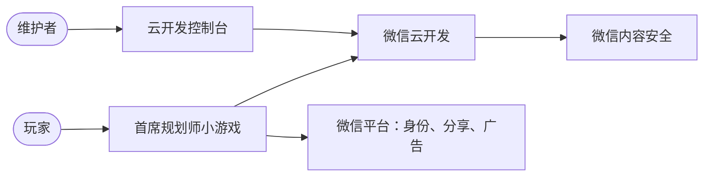
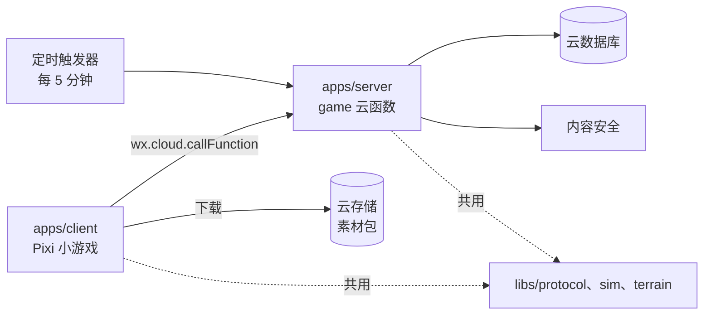
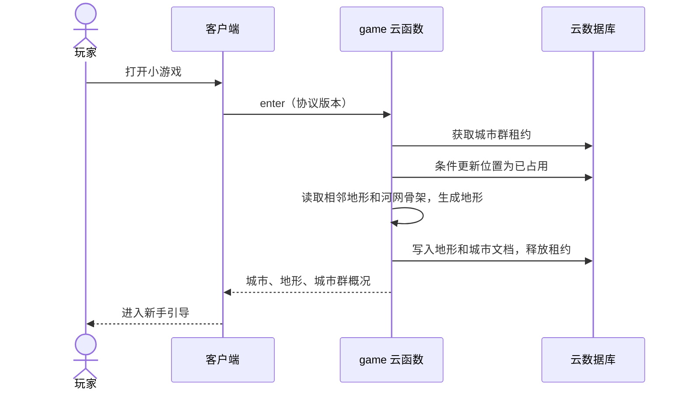
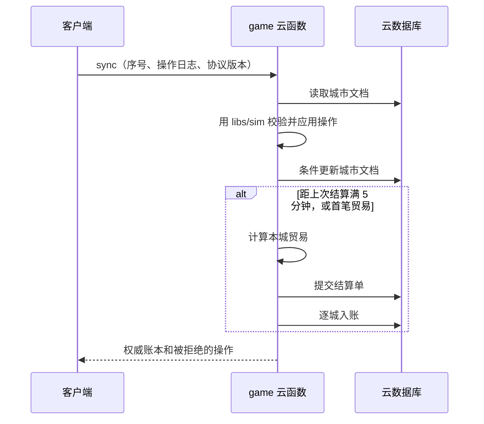
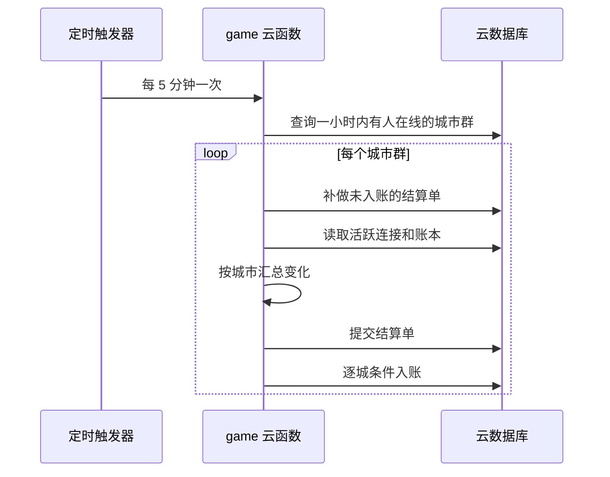
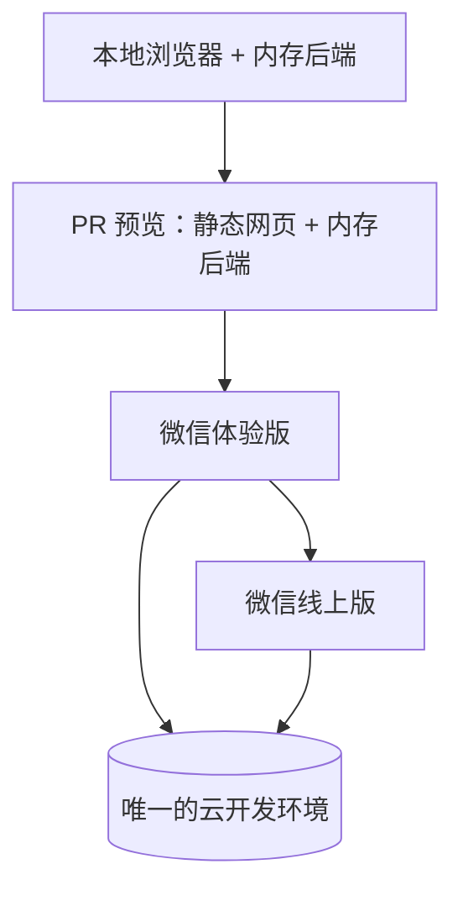

# 架构总览

相关决策见 `docs/adr/`。本文和 ADR 冲突时，以状态为"已接受"的最新 ADR 为准，并尽快修正本文。

## 架构指标

| 指标 | 目标 | 依据 |
|---|---|---|
| 日活 | 第一年 1000 到 1 万 | vision.md 约束 |
| 同时在线高峰 | 约 1000 人 | 推算：日活的 10% |
| 累计城市 | 1 万日活时约 9.6 万座，约 1400 个城市群 | ADR-0005 模拟 |
| 每城存储 | 地形约 0.6KB，建设数据约 10KB | ADR-0009 实测加推算 |
| 地形生成 | 服务端 P95 不超过 2 秒，含冷启动 | REQ-033，本地 P95 约 36 毫秒 |
| 同步接口 | P95 不超过 1 秒 | REQ-022 |
| 客户端 | 中端手机竖屏 30 帧，64×64 地图 | ADR-0003，待真机验证 |
| 包体 | 主包 4MB 内，总量按 20MB 规划 | ADR-0003 |
| 可用性 | 不要求 7×24，服务中断时可以本地建造 | vision.md 约束 |
| 强一致 | 位置占用、好友航线名额、结算单提交、玩家扣款 | REQ-011、REQ-018、REQ-021 |
| 最终一致 | 在线到账最多 5 分钟；世界地图、参观画面和留存统计可晚几分钟 | REQ-014、REQ-023、REQ-028 |
| 成本 | 不超过 REQ-027 的上限：没有广告收入时 100 元/月，有收入后不超过上月广告收入 | REQ-027 |
| 维护 | 一人加 AI，运维全自动化 | vision.md 约束 |

## 架构风格

微信云开发上的单入口模块化单体，加一个客户端和服务端共用的 TypeScript 规则库。城市内部模拟在手机上运行，资金、商品、等级、地形和贸易由服务端决定。详见 ADR-0002。

## 系统上下文

## 分层

| 层 | 职责 | 可以依赖 |
|---|---|---|
| `libs/protocol` | 接口和事件的 zod 定义、协议版本 | 不依赖其他层 |
| `libs/sim` | 纯函数规则：造价、产出、线路、贸易计算 | `libs/protocol` |
| `libs/terrain` | 纯函数地形和河网生成 | 不依赖其他层 |
| 客户端 `platform` | 微信和网页适配：画布、输入、存储、网络、分享 | `libs/protocol` |
| 客户端 `net` | 调用接口、操作日志、离线队列 | `platform`、`libs/protocol` |
| 客户端 `game` | 本地城市状态、模拟循环、交互流程 | `net`、`libs/sim`、`libs/terrain` 的类型 |
| 客户端 `render` | Pixi 分块绘制地图、建筑和线路 | `game` 的只读状态、`platform` |
| 客户端 `ui` | 面板和按钮 | `game`、`render` 的展示接口 |
| 服务端 `handler` | 入口路由、身份、校验、限流 | `modules/*/service`、`libs/protocol` |
| 服务端 `modules/*/service` | 业务规则 | 本模块 repository、其他模块的公开接口、`libs/*` |
| 服务端 `modules/*/repository` | 数据访问接口 | 不依赖 service |
| 服务端 `adapters` | 云开发和内存两套 repository 实现 | repository 接口 |

依赖规则由 dependency-cruiser 检查。`libs/*` 不能依赖 Pixi、`wx` 或云开发 SDK。

## 组件

| 组件 | 目录 | 技术栈 | 职责 | 拥有的数据 | 对外接口 | 依赖 |
|---|---|---|---|---|---|---|
| 小游戏客户端 | `apps/client` | TypeScript、PixiJS v8、@pixi/ui、@pixi/layout | 地图绘制、交互、本地模拟、离线队列 | 本地未同步的操作 | 无 | game 云函数、云存储、微信 API |
| 服务端 | `apps/server` | TypeScript、微信云函数 | 登录、世界、地形、城市、贸易、运营 | 见"数据" | `game` 云函数的 action | 云数据库、内容安全 |
| 规则库 | `libs/sim` | TypeScript | 客户端预测和服务端校验共用的规则 | 无 | 函数 | `libs/protocol` |
| 地形库 | `libs/terrain` | TypeScript | 河网骨架和地形生成 | 无 | 函数 | 无 |
| 协议库 | `libs/protocol` | TypeScript、zod | 接口定义和版本 | 无 | 类型和校验器 | 无 |

服务端模块：

| 模块 | 需求 | 拥有的集合 |
|---|---|---|
| `identity` | REQ-002、REQ-024、REQ-025 | `players` |
| `world` | REQ-011、REQ-012、REQ-017、REQ-020 | `clusters`、`invitations`、`archives` |
| `terrain` | REQ-033 | `terrains` |
| `city` | REQ-003 到 REQ-010、REQ-019、REQ-021、REQ-022、REQ-034、REQ-035 | `cities` |
| `trade` | REQ-013 到 REQ-016、REQ-018、REQ-036 到 REQ-038 | `routes`、`settlements`、`markets` |
| `ops` | REQ-026、REQ-027、REQ-028 | `events`、`dailyStats`、`costStatus` |

模块只通过公开接口互相调用，不直接读写其他模块的集合。

## 关键场景

### 新玩家进入并生成地形（REQ-011、REQ-033）

### 在线同步和结算（REQ-014、REQ-022）

### 定时结算（REQ-014、REQ-019）

## 部署

| 组件 | 环境 | 实例数 | 有无状态 | 扩容方式 | 健康检查 |
|---|---|---|---|---|---|
| 客户端 | 体验版和线上版 | 运行在玩家手机 | 本地队列 | 无需扩容 | 启动时检查协议版本 |
| game 云函数 | 云开发环境 | 按请求自动创建 | 无状态 | 平台自动 | `ping` action 和结算延迟指标 |
| 云数据库 | 云开发环境 | 平台托管 | 有状态 | 调整套餐 | 平台监控 |
| 客户端和内存后端 | 本地、PR 预览 | 单进程 | 内存 | 不适用 | 页面可打开 |

本地开发：`pnpm dev` 启动 Vite 网页版和内存后端，不需要 docker compose。微信专有行为用微信开发者工具和真机验证。

发布：合并到 main 后更新 PR 预览基线；推送 `v*` 标签后部署云函数和数据库索引，并用 miniprogram-ci 上传体验版。提审和发布由维护者在微信后台手动操作。公开发布前要把免费环境转为付费环境，否则发布后第 15 天到期，隔离期后环境被销毁。回滚：云函数部署上一标签，小游戏回退到上一线上版本。

## 数据

| 数据 | 主人 | 存储 | 一致性 | 备份 |
|---|---|---|---|---|
| 玩家身份和昵称 | identity | `players` | 强一致 | 平台备份，见 ADR-0005 |
| 城市群、位置和河网骨架 | world | `clusters` | 强一致，条件更新；骨架修改要持有租约 | 平台备份 |
| 地形 | terrain | `terrains` | 生成后不变 | 平台备份 |
| 城市文档：布局、资金、商品、等级、核定产出、配额 | city | `cities` | 强一致，条件更新；结算入账最终一致 | 平台备份 |
| 线路和好友航线名额 | trade | `routes` | 强一致 | 平台备份 |
| 结算单 | trade | `settlements` | 提交点强一致，入账幂等；保留 7 天 | 平台备份 |
| 外国市场价格 | trade | `markets` | 每日更新 | 可重新生成 |
| 回归城市存档 | world | `archives` | 最终一致，保留 1 年 | 平台备份 |
| 行为事件和日报 | ops | `events`、`dailyStats` | 最终一致，事件保留 90 天 | 无需备份 |
| 素材包 | 客户端发布流程 | 云存储 | 版本化，不可变 | 仓库可重建 |

贸易结算按"结算单"进行：先写入一份含全部城市变化的结算单作为提交点，再用条件更新逐城入账。结算单编号保证重跑不会重复。详见 ADR-0006。

数据结构变更方式：文档型数据按 `schemaVersion` 读取时兼容旧格式，再由 ops 批量回填；字段先加后删，分两次发布。回滚云函数不需要回滚数据。

## 横切关注点

| 方面 | 做法 |
|---|---|
| 认证授权 | 使用云函数上下文的 openid，映射到内部 playerId；数据库安全规则拒绝客户端直接访问，全部数据经云函数；管理 action 只允许环境变量里的 openid |
| 配置和密钥 | 云函数环境变量和仓库 secrets；miniprogram-ci 私钥只存在 GitHub secrets；规则数值放在 `libs/sim` 并随版本发布 |
| 日志、指标、追踪 | 每个请求生成 requestId 写结构化日志；ops 记录结算延迟、失败次数和成本估算；异常经微信订阅消息或邮件通知维护者 |
| 错误处理 | 错误码定义在 `libs/protocol`；可重试和不可重试分开；未知错误只返回 requestId |
| 限流和幂等 | 每玩家每分钟限制 action 次数；操作日志使用递增序号；邀请、航线和结算使用幂等键 |
| API 版本 | 请求带协议版本，服务端兼容当前和上一版；过旧版本提示更新小游戏 |
| 功能开关 | `config` 文档控制新玩家进入、邀请、贸易、激励视频和结算，云函数缓存一分钟 |

## 故障场景

| 故障 | 用户看到什么 | 系统怎么处理 | 怎么恢复 |
|---|---|---|---|
| 云函数失败或超时 | 右上角显示未同步，可以继续建造 | 操作留在本地队列，指数退避重试 | 恢复后自动同步 |
| 数据库配额用尽 | 贸易暂停提示，新玩家排队 | 关闭新玩家进入，服务端返回 retryAfter，客户端降低同步频率 | 升级套餐或等配额恢复 |
| 定时任务中断 | 离线城市数据更新变慢 | 下一轮补做未入账的结算单，因为按时间差结算不会丢收益 | 自动恢复，延迟超阈值时告警 |
| 结算中途失败 | 个别城市到账晚几秒到几分钟 | 结算单已提交，下次同步或结算补做入账 | 自动恢复 |
| 操作被服务端拒绝 | 被回滚的建筑消失，并提示原因 | 客户端回到服务端状态 | 玩家重新操作 |
| 地形生成失败 | 进入失败提示，可重试 | 释放位置和租约，重新生成或换位置 | 自动恢复 |
| 内容安全不可用 | 使用默认名称 | 保留默认名，稍后允许修改 | 自动恢复 |
| 素材下载失败 | 使用低清占位图，提示重试 | 分包重试，已缓存素材继续使用 | 网络恢复后替换 |
| 成本超过上限 | 新玩家提示稍后再来 | 暂停分配位置并通知维护者 | 调整上限后恢复 |
| 免费环境到期 | 服务不可用 | 上线前转为付费环境，到期前提醒维护者 | 转付费后恢复 |
| 数据被写坏 | 个别玩家异常 | 暂停结算，用平台备份回档 | 按备份恢复，结算单可重放 |

## 演进

- 日活持续超过 1 万或费用超过上限时：把结算拆成独立云函数，或迁到云托管；repository 接口让存储可替换。
- 平台绑定：`platform` 和 `adapters` 隔离微信专有能力，以后可以做抖音小游戏或网页版。
- 内购（REQ-032）：所有资金和商品已由服务端记账，接入时只增加支付模块。
- 联盟和竞赛（REQ-030）：城市群已是独立单元，可以挂载群级数据。
- 灾害（REQ-031）：`libs/sim` 预留事件入口，离线不触发。
- Cocos Creator：ADR-0003 真机验证失败时，`libs/*`、`net` 和服务端可以保留，只替换 `render`、`ui` 和 `platform`。
