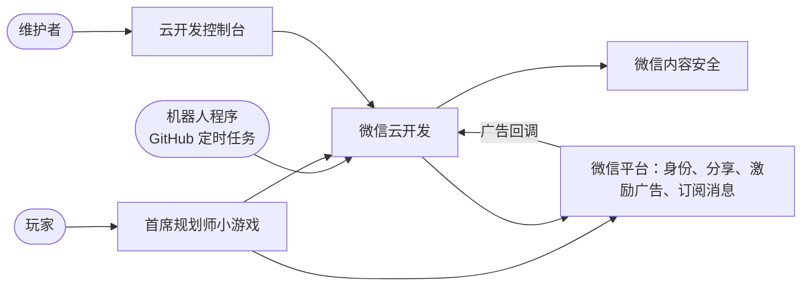
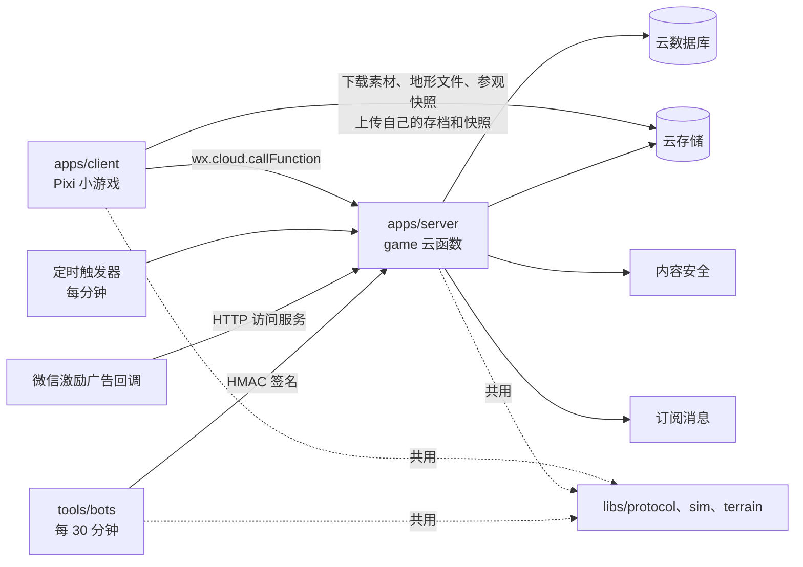
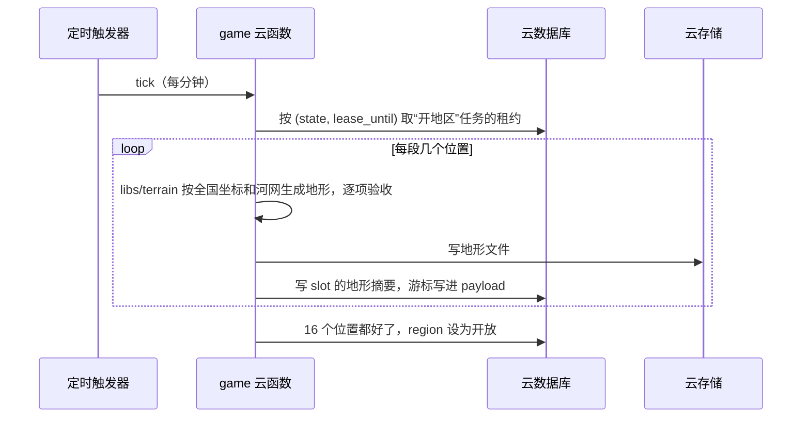
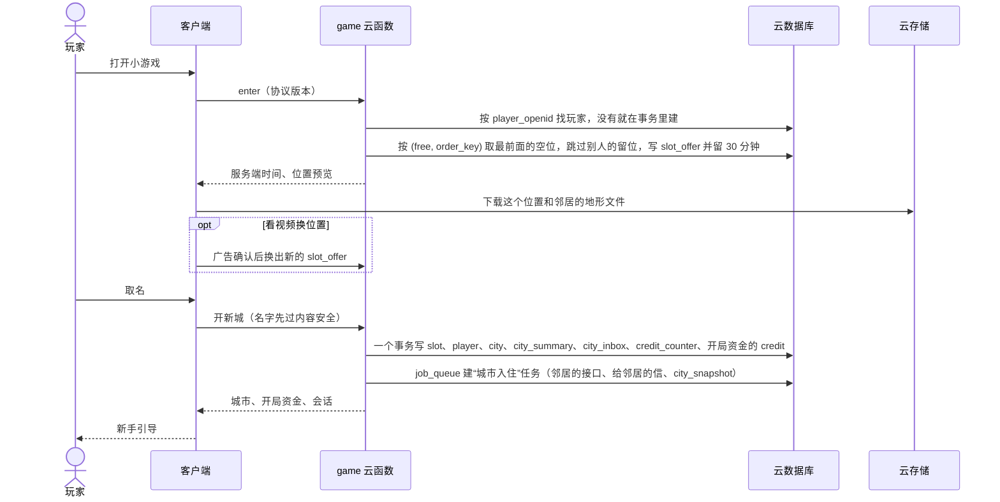
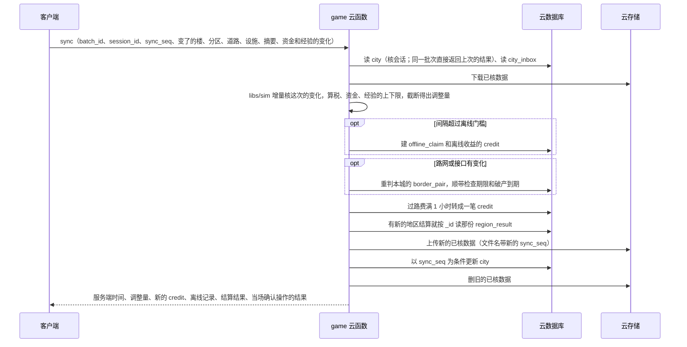
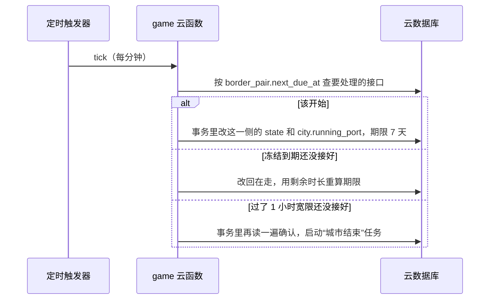
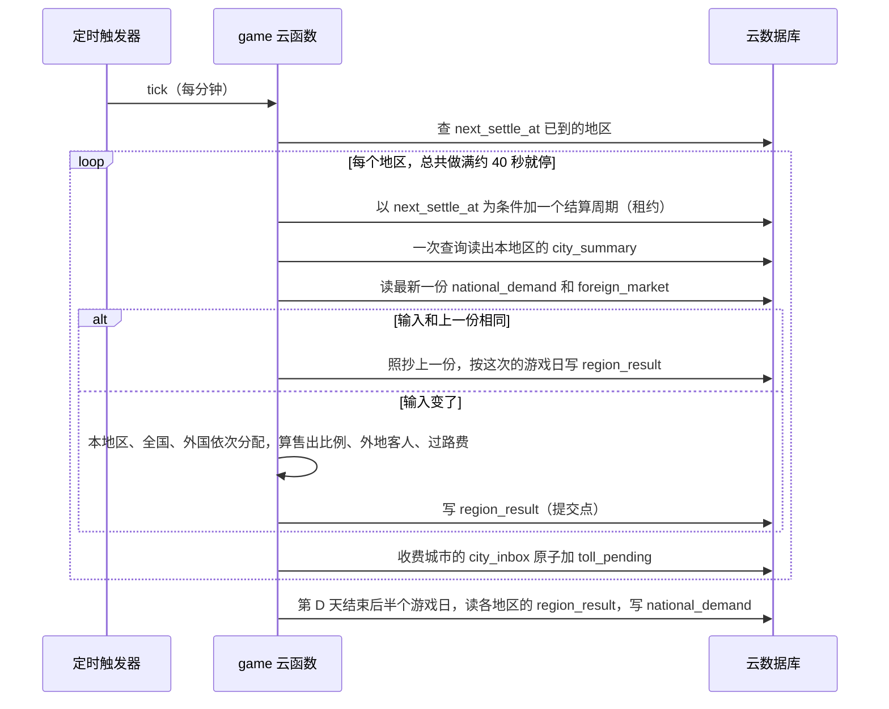
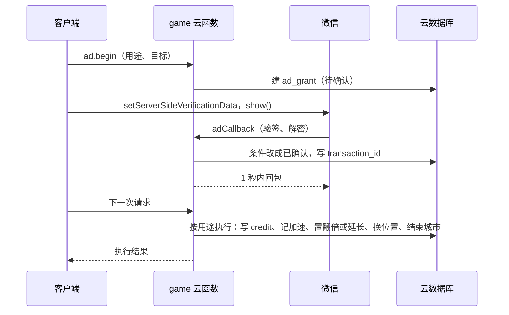
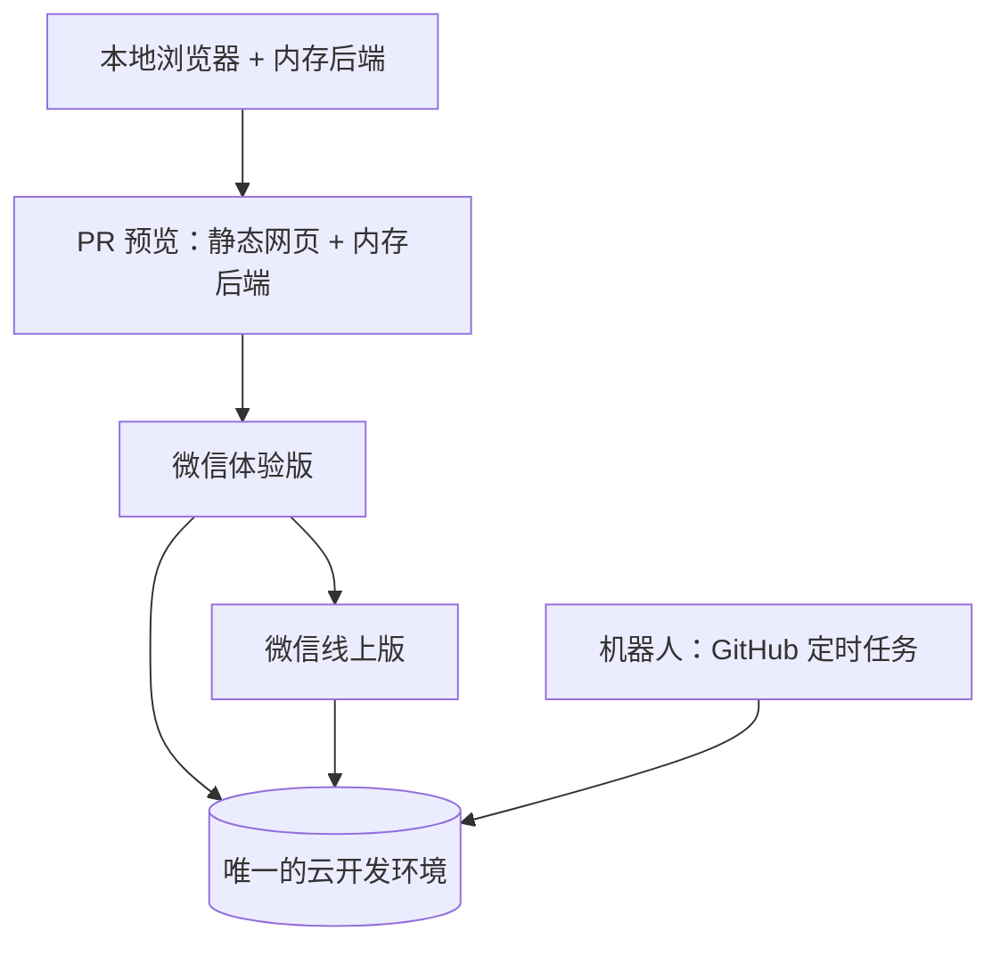

# 架构总览

相关决策见 `docs/adr/`，规则、表结构和实现大纲见 `docs/design/`（`game-design.md`、`data-model.md`、`sim-impl.md`、`server-impl.md`）。本文和 ADR 冲突时，以状态为“已接受”的最新 ADR 为准；本文和设计稿冲突时，以设计稿为准，并尽快修正本文。

客户端引擎（ADR-0003）和服务端平台（ADR-0005）的状态是“提议”：开发按这两份 ADR 进行，分别等 #24（手机性能和跨引擎一致）和 #25（云开发和微信平台的限制）实测后接受；实测不达标时按各自 ADR 里写好的退路改。

## 架构指标

| 指标 | 目标 | 依据 |
|---|---|---|
| 日活 | 第一年 1000 到 1 万 | vision.md 约束 |
| 同时在线高峰 | 约 1000 人 | 推算：日活的 10% |
| 世界规模 | 国家 → 4×4 共 16 个位置的地区 → 256×256 格的城市；新玩家按顺序填最前面的空位，地区住满才开下一个；一人同一时刻一座在用的城市 | `game-design.md` 第 2 节 |
| 每城存储 | 完整存档压缩后 300 到 600 KB；已核数据约 150 KB；参观快照约 100 KB；每个位置的地形文件约 20 到 40 KB | `data-model.md` 第 15 节、`sim-impl.md` 第 1 节，待 #24、#25 实测 |
| 地形生成 | 开地区任务在后台生成，玩家取名前地形已就绪；服务端一个位置不超过约 10 秒 | REQ-033、ADR-0001，待 #23 实测 |
| 同步 | 在线每 2 分钟一次，只报变化；256 格一次同步 1 到 2 秒（256 MB 内存） | REQ-022、`game-design.md` 第 15 节，待 #25 实测 |
| 客户端 | 中端手机竖屏 30 帧，256×256 满城约 1 万栋楼 | ADR-0003、ADR-0010，待 #24 实测 |
| 交通分配 | 满城一次完整分配不超过 2 秒，分摊后每帧不超过 1 毫秒 | REQ-005、`game-design.md` 第 15 节，待 #24 实测 |
| 离线补算 | 离线 8 小时回来，中端安卓不超过 5 秒 | REQ-019、`game-design.md` 第 12 节，待 #24 实测 |
| 包体 | 主包 4MB 内，总量按 20MB 规划 | ADR-0003、Q-007 |
| 可用性 | 不要求 7×24，服务中断或维护时本地照常玩和建造 | vision.md 约束 |
| 强一致 | 位置占用和留位、开新城、接口占位和期限、入账（防重和序号）、等级确认、地区结算的租约 | REQ-011、REQ-013、REQ-020、REQ-021 |
| 最终一致 | 城市之间的售出率、外地客人和过路费按地区每个游戏日（现实 24 分钟）结算一次；灰色浏览和参观看到最近一次同步的样子；留存统计可晚几分钟 | REQ-014、REQ-023、REQ-028 |
| 成本 | 不超过 REQ-027 的上限：没有广告收入时 100 元/月，有收入后不超过上月广告收入；按分项成本表约 650 日活到 100 元/月 | REQ-027、`data-model.md` 第 15 节 |
| 维护 | 一人加 AI，运维全自动化 | vision.md 约束 |

## 架构风格

微信云开发上的单入口模块化单体，加一个客户端和服务端共用的 TypeScript 规则库。服务器不持续模拟城市：城市的模拟和本城内部的买卖都在玩家手机上运行；服务端只校验、写入账记录、按地区算城市之间的货运和外地客人、按国家汇总全国需求，再处理接口期限和后台任务。资金只由手机写，服务端从不直接改资金。详见 ADR-0002、ADR-0006。

## 系统上下文

## 分层

| 层 | 职责 | 可以依赖 |
|---|---|---|
| `libs/protocol` | 接口和事件的 zod 定义、错误码、协议版本 | 不依赖其他层 |
| `libs/sim` | 纯函数规则和配置表：造价、生长、人和岗位、交通、本城市场、地区结算的分配、校验的上下限 | `libs/protocol` |
| `libs/terrain` | 纯函数地形和河网生成，只在服务端的开地区任务里运行；手机只读地形文件 | 不依赖其他层 |
| 客户端 `platform` | 微信和网页适配：画布、输入、存储、网络、分享、广告、订阅消息 | `libs/protocol` |
| 客户端 `net` | 调用接口、离线队列、按批次同步 | `platform`、`libs/protocol` |
| 客户端 `game` | 本地城市状态、模拟调度器、离线补算、交互流程 | `net`、`libs/sim`、`libs/terrain` 的类型 |
| 客户端 `render` | Pixi 按 16×16 分块绘制地图、建筑和线路 | `game` 的只读状态、`platform` |
| 客户端 `ui` | 面板和按钮 | `game`、`render` 的展示接口 |
| 服务端 `handler` | 入口路由、身份、会话、校验、限流 | `modules/*/service`、`libs/protocol` |
| 服务端 `modules/*/service` | 业务规则的编排；计算放在 `libs/sim` | 本模块 repository、其他模块的公开接口、`libs/*` |
| 服务端 `modules/*/repository` | 数据访问接口 | 不依赖 service |
| 服务端 `adapters` | 云开发和内存两套 repository 实现 | repository 接口 |

依赖规则由 dependency-cruiser 检查。`libs/*` 不能依赖 Pixi、`wx` 或云开发 SDK。

**共用规则的确定性**：两端都要算的规则只用整数和定点数，不用三角函数、`pow`、`exp`、`log` 这类浮点函数，也不用 `Math.random` 和 `Date`、不读本地时间，由 lint 禁用。伪随机用 32 位整数发生器，种子是“城市种子 + 楼的编号 + 第几次生长”，遍历一律按编号顺序。跨引擎金标准测试：同一组共用规则的输入，在 Node、安卓真机、iOS 真机上算出的哈希一致；不一致就找出用了浮点的规则改成定点数（#24）。

## 组件

| 组件 | 目录 | 技术栈 | 职责 | 拥有的数据 | 对外接口 | 依赖 |
|---|---|---|---|---|---|---|
| 小游戏客户端 | `apps/client` | TypeScript、PixiJS v8、@pixi/ui、@pixi/layout | 地图绘制、交互、本地模拟、离线补算、离线队列 | 本地存档（双份写）和没同步的操作 | 无 | game 云函数、云存储、微信 API |
| 服务端 | `apps/server` | TypeScript、微信云函数 | 身份、世界、地形、城市、货运和入账、运营 | 见“数据” | `game` 云函数的 action、广告回调、定时 tick | 云数据库、云存储、内容安全、订阅消息 |
| 规则库 | `libs/sim` | TypeScript | 手机模拟、服务端校验和地区结算共用的规则 | 无 | 函数和配置表 | `libs/protocol` |
| 地形库 | `libs/terrain` | TypeScript | 河网和地形生成 | 无 | 函数 | 无 |
| 协议库 | `libs/protocol` | TypeScript、zod | 接口定义、错误码和版本 | 无 | 类型和校验器 | 无 |
| 机器人 | `tools/bots` | TypeScript、云开发 Node SDK | 内测用：下载存档、无界面模拟、按规则造城、同步、上传 | 无 | 无 | game 云函数、`libs/sim` |

服务端模块：

| 模块 | 需求 | 拥有的集合和文件 |
|---|---|---|
| `identity` | REQ-002、REQ-023（头像和昵称）、REQ-024、REQ-025 | `player`、`player_openid` |
| `world` | REQ-011、REQ-017、REQ-023（好友）、REQ-039、REQ-048 | `country`、`region`、`slot`、`gateway`、`slot_offer`、`invitation`、`friendship` |
| `terrain` | REQ-033、REQ-034 | `river_network`、地形文件 |
| `city` | REQ-003 到 REQ-010、REQ-013、REQ-019、REQ-020、REQ-021、REQ-022、REQ-035、REQ-040、REQ-041、REQ-045 到 REQ-047 | `city`、`city_inbox`、`city_summary`、`city_snapshot`、`border_pair`、`sync_audit`、完整存档、已核数据、参观快照 |
| `trade` | REQ-014、REQ-015、REQ-016、REQ-019（离线收益）、REQ-027、REQ-036、REQ-038、REQ-042 | `region_result`、`national_demand`、`foreign_market`、`credit`、`credit_counter`、`ad_grant`、`free_grant`、`offline_claim`、`reward` |
| `ops` | REQ-026、REQ-027（开关）、REQ-028、REQ-043、REQ-044 | `mail`、`wx_notify_quota`、`job_queue`、`ops_switch` |

模块只通过公开接口互相调用，不直接读写其他模块的集合。表的字段和 `_id` 规则见 `data-model.md` 和它的附录；留存统计的数据怎么存，设计稿还没定。

## 关键场景

### 开地区（REQ-011、REQ-033）

当前地区还剩 4 个空位时就预生成下一个地区；当前国家只剩最后一个地区可开时，预生成下一个国家。

### 新玩家进入和开局（REQ-002、REQ-011、REQ-025、REQ-039、REQ-040）

取名时位置已被别人占了，自动免费换成下一个空位。被邀请的玩家跳过预览和换位置，直接放在邀请人旁边留住的位置。新城有 3 天保护期。

### 在线同步（REQ-021、REQ-022）

条件更新失败说明同时有另一次同步：删掉刚传的文件，3 秒内重来一次，再不行返回“请重试”。修到边界、接线头、拆边界段、撤销线头这些当场确认的操作和一次同步合成一个请求，服务端先核完这批变化，再在最新的已核路网上检查。离线回来变化多时分批报，报完之前服务端按旧的已核数据封顶。步骤的细节见 `data-model.md` 第 7 节。

### 接口期限（REQ-013、REQ-020）

tick 不发通知；每小时的通知任务按 next_due_at 查出 7 天内要处理的接口，按规则发微信服务通知。服务端出故障时，维护者打开“暂停全部接口期限”，关上时把暂停的时长加回每个期限。

### 地区结算和国家汇总（REQ-014、REQ-015、REQ-042）

8 小时内一座城市都没上线的地区跳过。结算周期默认一个游戏日，各地区的 settle_offset 让结算时刻错开。中途失败这一天就丢掉，手机沿用最近的结果。

### 激励视频（REQ-027）

已确认超过 2 分钟还没执行的，由 tick 执行。领钱的触点先显示“到账中”，回调到达前这笔钱不能花。回调做不到时，按 `data-model.md` 第 10 节的退路以手机报的“看完了”执行并按天限次；广告不可用时，同一个按钮按天限次直接领取。

### 城市结束（REQ-020）

job_queue 的“城市结束”任务按步骤接力（`data-model.md` 第 8 节）：city 改成结束中 → city_summary 标 ended，结算从此跳过它 → 逐份处理它的 border_pair（它这一侧清成“无”，对面正在接它的工程取消并全额退款，对面的期限重排，给邻居写信）→ 清 slot 和 player.city_id，地区回到开放 → 删完整存档和已核数据 → city 改成历史。邻居修到它边界上的高速线和铁路线留在原处，等新城市过了保护期后算对新城市的请求。

## 部署

| 组件 | 环境 | 实例数 | 有无状态 | 扩容方式 | 健康检查 |
|---|---|---|---|---|---|
| 客户端 | 体验版和线上版 | 运行在玩家手机 | 本地存档和离线队列 | 无需扩容 | 启动时检查协议版本和配置版本 |
| game 云函数 | 云开发环境 | 按请求自动创建 | 无状态，开关和配置在实例里缓存 60 秒 | 平台自动 | `ping` action、地区结算落后 next_settle_at 的时长、job_queue 的重试次数 |
| 云数据库、云存储 | 云开发环境 | 平台托管 | 有状态 | 调整套餐 | 平台监控 |
| 机器人 | GitHub 定时任务，每 30 分钟 | 一次跑完 | 无状态，存档在云存储 | 不适用 | 任务日志 |
| 客户端和内存后端 | 本地、PR 预览 | 单进程 | 内存 | 不适用 | 页面可打开 |

本地开发：`pnpm dev` 启动 Vite 网页版和内存后端，不需要 docker compose。微信专有行为用微信开发者工具和真机验证。

发布：合并到 main 后更新 PR 预览基线；推送 `v*` 标签后部署云函数和数据库索引，并用 miniprogram-ci 上传体验版。提审和发布由维护者在微信后台手动操作。公开发布前要把免费环境转为付费环境，否则发布后第 15 天到期，隔离期后环境被销毁。内测世界在正式发布前整体清空，国家从 1 重新生成，内测玩家的城市不保留。回滚：云函数部署上一标签，小游戏回退到上一线上版本。

## 数据

| 数据 | 主人 | 存储 | 一致性 | 保留期 |
|---|---|---|---|---|
| 玩家身份、昵称和头像 | identity | `player`、`player_openid` | 强一致；第一次进入时在事务里建，撞 `_id` 的一方重读 | 注销时删 |
| 国家、地区、位置、口岸 | world | `country`、`region`、`slot`、`gateway` | 位置占用以 `slot.city_id` 为条件更新；留位过期在读的时候判断 | 长期 |
| 留位、位置预览、邀请、好友 | world | `slot_offer`、`invitation`、`friendship` | 强一致，条件更新 | 留位 30 分钟，过期的由每日维护删 |
| 河网和地形 | terrain | `river_network`、云存储的地形文件 | 按国家的 terrain_version 生成后不变；手机按版本缓存 | 旧版本的文件保留 |
| 城市 | city | `city` | 同步以 sync_seq 为条件更新；带旧会话的同步被拒绝 | 在用的城市在玩家 30 天没打开游戏时结束；历史城市保留到玩家永久删除，或玩家 180 天没上线时自动清掉 |
| 完整存档 | city（手机写） | 云存储 | 有改动时每 5 分钟上传，退后台和当场确认的操作后也传；重建基线只认 `city.save_hash` | 城市结束时删 |
| 已核数据 | city（只有云函数写） | 云存储 `verified/<city_id>/<sync_seq>` | 每次同步一读一写一删旧 | 城市结束时删 |
| 参观快照、灰色浏览的干线 | city | 云存储的参观快照、`city_snapshot` | 每个游戏日和退后台时生成；有变化才写 | 跟着城市；历史城市保留结束那一刻的 |
| 接口和期限 | city | `border_pair` | 以 version 为条件更新；改 `city.running_port` 的事务以读到的值为条件 | 两边都没有线头、也没有期限时删 |
| 城市摘要和收件箱 | city | `city_summary`、`city_inbox` | 摘要只在新游戏日的第一次同步、影响别人的字段变了、城市结束时写 | 城市结束时摘要标 ended，结算从此跳过它 |
| 校验记录 | city | `sync_audit` | 每游戏日一行 | 注销时删 |
| 地区结算、全国需求、外国市场 | trade | `region_result`、`national_demand`、`foreign_market` | 写 region_result 就是提交点；国家汇总用最新一份，不等 | region_result 保留最近 3 天 |
| 入账 | trade | `credit`、`credit_counter`、`offline_claim`、`reward` | `_id` 是“来源:来源编号”，天然防重；seq 不留空洞 | 已计入超过 7 天的 credit 删掉 |
| 激励广告和直接领取 | trade | `ad_grant`、`free_grant` | transaction_id 唯一；free_grant 的 `_id` 带日期和次数 | 注销时去掉 player_id |
| 站内信和订阅额度 | ops | `mail`、`wx_notify_quota` | 写信时给收信玩家的 city_inbox.mail_version 加一 | 已读、已解决的信 30 天后删，待处理和未领取的不删 |
| 分段任务和运营开关 | ops | `job_queue`、`ops_switch` | 以 lease_until 和 owner 取租约；开关在实例里缓存 60 秒 | 长期 |
| 素材包 | 客户端发布流程 | 云存储 | 版本化，不可变 | 仓库可重建 |

存放的原则（ADR-0006）：服务端要读的字段放云数据库；地形、完整存档、已核数据和参观快照放云存储文件；只有手机用的状态（引导进度、看过的“新”标签、最近日账、月度统计）只放在完整存档里。资金只由手机写：服务端只往 `credit` 里写入账记录，手机按 seq 顺序计入；核不上时服务端返回调整量，手机当作一笔更正静默计入。

注销由 job_queue 的“注销”任务分步删掉这个玩家的全部数据，不设撤回期（`data-model.md` 第 8 节）。每日维护对账一次：city 和 slot 互相指向、player.city_id 指向在用的城市、border_pair 的城市字段和 slot 一致，不一致以 slot 为准修正。备份用平台备份，个人版有没有数据回档待 #25 核实。

数据结构变更方式：存档头带 schema_version 和 config_version，读取时兼容旧格式；服务端同时支持当前和上一版配置，更旧的拒绝并提示更新；数据库字段先加后删，分两次发布，回滚云函数不需要回滚数据。

## 横切关注点

| 方面 | 做法 |
|---|---|
| 认证授权 | 用云函数上下文的 openid，加盐哈希后作为 `player_openid` 的 `_id`，openid 本身不存、不发给客户端；每个请求校验城市属于调用者，广告的目标编号也一样；数据库安全规则拒绝客户端直接访问，全部数据经云函数；云存储里手机只能写自己的路径，已核数据和地形文件只有云函数能写；没有 openid 的调用（维护者、机器人）必须带用环境变量里的密钥算的 HMAC 签名 |
| 配置和密钥 | 云函数环境变量和仓库 secrets：广告回调的 Token 和 EncodingAESKey、HMAC 密钥、miniprogram-ci 私钥（只在 GitHub secrets）；规则数值放在 `libs/sim` 的配置表（Q-006），两端读同一份，存档只存配置版本号 |
| 时间 | 所有时刻以服务端为准：进入和同步的响应带服务端时间，手机算偏移，再用单调时钟往前走；“天”按北京时间；服务端的结算和汇总按国家日历，城里的事按城市日历 |
| 共用规则 | 只用整数和定点数，lint 禁用浮点函数、随机数和本地时间；跨引擎金标准测试见“分层” |
| 日志、指标、追踪 | 每个请求生成 requestId 写结构化日志，日志里 openid 只写哈希；sync_audit 每游戏日记核了几次、截断了几次；ops 记地区结算延迟和 job_queue 重试，超过阈值时告警 |
| 错误处理 | 错误码定义在 `libs/protocol`：会话过期、城市已结束、同步冲突、配置版本太旧、协议不兼容、截断、修线头被拒；可重试和不可重试分开；未知错误只返回 requestId |
| 限流和幂等 | 每玩家每分钟限制 action 次数；同步带 batch_id，同一批次重发时原样返回上次的结果；入账按“来源:来源编号”防重；广告回调按 transaction_id 防重；直接领取按“玩家_用途_日期_第几次”防重 |
| API 版本 | 请求带协议版本，服务端兼容当前和上一版；过旧版本提示更新小游戏，协议不兼容时整屏只有“重启” |
| 功能开关 | `ops_switch`：广告直接领取和每种用途每天的次数、新手引导、各视频触点、暂停新玩家进入、同步间隔（默认 2 分钟）、结算周期（默认 1 个游戏日）、结算总开关、暂停全部接口期限、最低客户端版本；函数实例里缓存 60 秒，改了一分钟内生效 |

## 定时任务

一个每分钟的定时触发器，`tick` 依次做下面几件事，做满约 40 秒就停，没做完的下一分钟接着做（`server-impl.md` 第 7 节）：

1. 按 next_due_at 处理接口期限的开始、冻结到期和到期判定，不发通知。
2. 按 next_settle_at 做地区结算；地区结算不进 job_queue。
3. 国家汇总。
4. 已确认超过 2 分钟还没执行的激励广告。
5. job_queue 里的分段任务：开地区、城市入住、城市结束、注销、每日维护。
6. 每小时第 0 分钟跑通知任务；每天 04:00 建当天的维护任务。

每日维护：30 天没上线的玩家的城市结束；180 天没上线的玩家的历史城市删掉；过期的站内信、留位和 slot_offer；7 天前已计入的 credit；外国市场的需求上限；对账。机器人在 GitHub 定时任务里每 30 分钟跑一次，不占云函数的定时触发器。

## 故障场景

| 故障 | 用户看到什么 | 系统怎么处理 | 怎么恢复 |
|---|---|---|---|
| 云函数失败、超时或断网 | 城市名旁一个断网小图标，要联网的功能置灰，本地照常玩和造 | 操作按批次留在离线队列，指数退避重试；本地记的税和维护费只是临时的 | 恢复后自动同步，资金按秒平滑修正到服务端的数，不弹窗 |
| 服务器维护 | 顶部一条“维护中，预计 HH:MM 结束”，本地照常玩 | 维护者按需打开“暂停全部接口期限” | 维护结束后自动同步；关掉暂停时把暂停的时长加回期限 |
| 另一台设备打开了同一座城 | 先打开的设备整屏“在另一台设备上打开了” | 带旧会话的同步被拒绝 | 点“在这台继续”重新拉存档，没同步的操作丢掉 |
| 同步冲突 | 无感，最多一次重试 | 删掉刚传的已核数据，3 秒内重来一次 | 再失败返回“请重试”，下一次同步接着做 |
| 上报超出上限 | 资金或经验平滑跳到新值 | 截断并记进 sync_audit，返回调整量 | 手机当作一笔更正计入 |
| 定时触发中断 | 期限、结算和后台任务推迟 | next_due_at、next_settle_at 和 job_queue 的游标都还在 | 恢复后接着做；期限受影响时维护者打开暂停开关 |
| 地区结算中途失败 | 城市之间的售出率晚一天更新 | 这一天的结果丢掉，手机沿用最近 3 次结算的平均 | 下一个结算周期自动恢复 |
| 广告回调没来 | 按钮转一下后什么都没有，或“到账中”一直不变成正式资金 | 不执行奖励；已确认超过 2 分钟的由 tick 执行 | 回调到了自动执行；做不到回调时走退路 |
| 开地区慢或失败 | 新玩家稍等 | 提前一个地区预生成；分段任务重试，超过次数告警 | 维护者处理后重跑 |
| 内容安全不可用 | 使用默认名“某某的城市” | 保留默认名，之后允许改名 | 自动恢复 |
| 素材或地形文件下载失败 | 使用低清占位图，提示重试 | 分包重试，已缓存的继续使用 | 网络恢复后换上正式素材 |
| 存档损坏或换手机 | 加载页“正在恢复你的城市” | 从云端取存档，第一次同步走重建基线，资金用服务端记下的数 | 自动恢复 |
| 成本到上限 | 新玩家提示稍后再来 | 打开“暂停新玩家进入”并通知维护者；可以调长同步间隔和结算周期 | 调整上限后恢复 |
| 免费环境到期 | 服务不可用 | 上线前转为付费环境，到期前提醒维护者 | 转付费后恢复 |
| 数据被写坏 | 个别玩家异常 | 关掉结算总开关，用平台备份回档 | 按备份恢复；每日维护以 slot 为准对账 |
| 协议不兼容 | 整屏只有“重启” | 拒绝旧版本请求 | 玩家重启小游戏后更新 |

## 演进

- 日活持续超过 1 万或费用超过上限时：先调同步间隔和结算周期；再把地区结算拆成独立云函数，或迁到云托管；repository 接口让存储可以更换。
- 平台绑定：`platform` 和 `adapters` 隔离微信专有能力，以后可以做抖音小游戏或网页版。
- 内购（REQ-032）：资金的进账已经全部走服务端写的入账记录，接入时只增加支付模块和一种入账来源。
- 联盟和竞赛（REQ-030）：地区已是独立的数据单元，可以挂载地区级数据。
- 灾害（REQ-031）：`libs/sim` 预留事件入口，离线不触发。
- 10 级以后的内容（摩天楼、高铁）：等级表和配置表按版本扩展。
- Cocos Creator：ADR-0003 真机验证失败时，`libs/*`、`net` 和服务端可以保留，只换掉 `render`、`ui` 和 `platform`。
