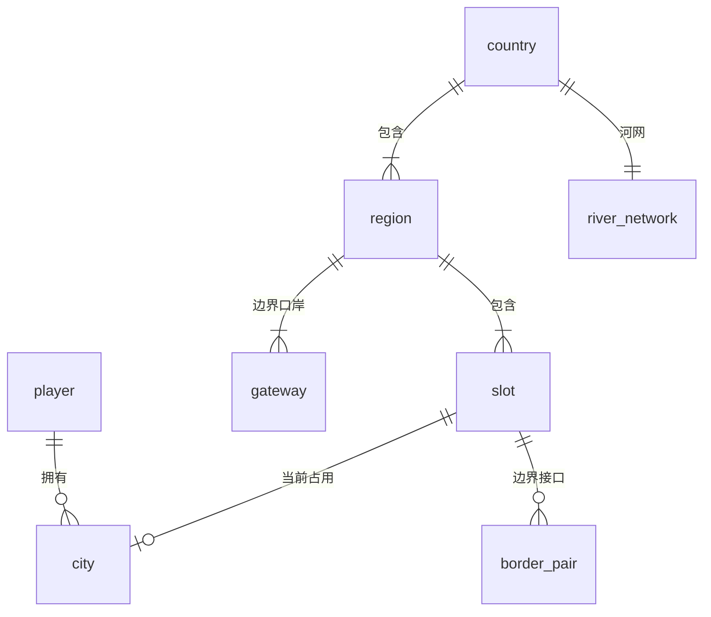

# 数据结构

游戏里每样东西存什么、存在哪、多久更新一次。规则的来由见 `game-design.md`，分区里长出什么和奖励建筑见 `catalog.md`。表名和字段用英文，和代码里的命名一致；术语对照见 `docs/product/glossary.md`。

状态：2026-11-03 初稿，已按九轮审查修订，待用户确认。字段类型在实现时再定；各表的 _id 规则和索引见附录。

## 1. 存储原则

- **服务器不持续模拟城市**（REQ-027）。城市在玩家的手机上模拟，本城内部的买卖也在手机上算；服务端只校验、记账、按地区算城市之间的货运和外地客人，按国家汇总全国需求。
- **几种存储，各放各的**：

| 存储 | 放什么 | 为什么 |
|---|---|---|
| 云数据库（文档型） | 本文里的表：玩家、城市、接口、摘要、入账、结算结果、站内信 | 要按字段改、要原子加一和事务、要查询 |
| 云存储文件：地形 | 每个位置一份，服务端开地区时生成（见第 2 节） | 只生成一次，两端用同一份，不同手机算出的格子不会差一格；可以走 CDN，手机按版本缓存 |
| 云存储文件：完整存档 | 每座城市的对象层、模拟数据和只有手机用的状态，打包压缩 | 大，只在换手机恢复时整份读 |
| 云存储文件：参观快照 | 别人参观和看历史城市用的只读画面数据（见第 12 节） | 比完整存档小，可以缓存 |
| 云存储文件：已核数据 | 服务端核对用的精简数据（见第 7 节） | 每次同步一读一写，按次计费比数据库便宜；只有云函数写 |

- **城市文档只放服务端要读的字段**；只有手机用的状态（引导进度、看过的“新”标签、离线闪烁清单、最近日账、经验记录、月度统计）放在完整存档里。统计只在手机上看。
- **运维成本最低**：留在个人版套餐里，不开常驻实例。`game` 云函数超时 60 秒；一个每分钟的定时触发器按顺序处理期限、结算和 job_queue，做满约 40 秒就停，没做完的下一分钟接着做。
- **各管各的城**：每座城市的存档只有自己城里的东西；邻居之间只在数据库里记边界接口，谁也不在别人的存档里放对象。
- **一人一城**：一个玩家同一时刻只有一座在用的城市；结束的城市成为历史城市，只留 city 记录和参观快照（见第 8 节）。
- **存档只存算不出来、或者重算太慢的东西**。覆盖、需求条、住户收入星级、楼的目标星级、实心星和空心星、接口接没接好，打开游戏时都能重算，不进存档。交通负荷一次完整分配要秒级，进存档。
- **慢慢变化的值**：存当前值和上次更新的游戏时间。离线补算先按游戏日推进，再按小时细算最后 1 个游戏日；按日推进时满意度和售出率冻结在离开那一刻，交通用存档里的结果。补算不记税、维护费和经验，这三样只按离线记录算（见 `game-design.md` 第 12 节）。
- **随机结果写进存档**：楼长在哪、长哪一类、哪个品种、哪套造型，用“城市种子 + 楼的编号 + 第几次生长”算出后存下来，换手机和别人参观时都一样。`libs/sim` 里服务端要复算的规则只用整数和定点数，不用 Math.sin、pow 这类浮点函数，也不用 random 和 Date（lint 禁用），并有跨引擎的金标准测试。
- **规则数值放配置**：分区目录、楼的尺寸表、奖励建筑的修正和占地、价格、门槛、半径、费率、折扣、经验换算比例、新居民学历比例、视频资金的小时数、保护期长度、接口最小间距、离线门槛、滑动平均的半衰期都在 `libs/sim` 的配置表里（Q-006），两端读同一份；存档只存配置版本号。服务端同时支持当前和上一版配置，更旧的拒绝并提示更新。
- **资金只有手机写**：服务端从不改资金，只往统一的入账表里写记录。每座城市的入账记录按 seq 递增编号，手机按 seq 顺序计入，同步时回报计入到哪一条。服务端截断时返回调整量，手机当作一笔更正计入。
- **同步只传变化**：在线时每 2 分钟同步一次操作日志、变了的楼、分区、道路和设施、城市摘要、资金和经验的变化（REQ-022），间隔在运营配置里。别人看到的是最近一次同步的样子。修到边界、接邻居线头、拆边界段、撤销线头这几种操作要联网，和一次同步合成一个请求，由服务端当场确认。完整存档有改动时每 5 个现实分钟上传一次，退后台和当场确认的操作之后也传。
- **时间以服务端为准**：进入和同步的响应带服务端时间，手机算偏移，再用单调时钟往前走。“天”是现实中的一天，按北京时间计；按游戏日计的字段在名字里带 game。金额用整数（分）。
- **世界数据都带 country_id**。内测世界在正式发布前整体清空，国家从 1 重新生成，内测玩家的城市不保留；清空就是按国家删。

## 2. 世界

| 表 | 主要字段 | 说明 |
|---|---|---|
| country | id、seq、name、seed、terrain_version、clock_origin、shape、created_at | seq 是国家的分配顺序；名字由系统起；seed 和 terrain_version 决定全国的地形，由服务端按版本生成，旧版本的文件保留；国家时钟决定昼夜和日期 |
| region | id、country_id、seq、name、grid_x、grid_y、climate、settle_offset、next_settle_at、state、city_count、opened_at | seq 是地区在国家里的分配顺序；climate：寒冷、温和、炎热；settle_offset 让各地区的结算时刻错开，都在半个游戏日内；next_settle_at 是下一次结算的时刻（见第 9 节）；state：生成中、开放、已满，城市结束空出位置时回到开放；city_count 给地区视图用，入住和结束时改 |
| slot | id、region_id、x、y、seq、order_key、free、coastal、gateway_id、edge、terrain_score、edge_buildable、mineral_area、city_id、held_by、held_until、held_for | seq 是位置在地区里的分配顺序（1 到 16，每个新位置都紧挨更靠前的位置，口岸靠前）；order_key = 国家 × 10⁶ + 地区 × 100 + 位置，free 表示没有城市，按 (free, order_key) 找最前面的空位；coastal、edge 是标志，gateway_id 不为空就是陆路口岸；terrain_score、edge_buildable（四条边上能接线头的地段）、mineral_area 是地形文件的小摘要，选位置和修到边界的检查只读它；held_by、held_until、held_for 是给某个玩家留的位，held_for 写明是开局分配、换位置还是邀请，过期在读的时候判断 |
| gateway | id、slot_a、slot_b | 一对面对面的陆路口岸位置；相邻地区的共享边上 1 到 2 对。河跨地区的地方不设口岸 |
| 地形文件 | heights、surface、water、navigable、minerals、forest、edge_buildable | 云存储里每个位置一份，路径带 country、terrain_version 和位置；256×256；navigable 标出能通航的河段，每个位置至少有一段穿城；手机下载后按版本缓存，不在本地生成；服务端核对时读它 |
| river_network | country_id、paths、slot_entries | 按国家生成，流过每个位置，包括空白位置；slot_entries 记每个位置的河从哪进、从哪出，水运选路用 |

- 开地区是 job_queue 里的分段任务：每段生成几个位置的地形文件，写 slot 上的摘要，16 个都好了才把 region 设为开放，所以玩家取名之前地形已经就绪。当前地区还剩 4 个空位时就预生成下一个地区；当前国家只剩最后一个地区可开时，预生成下一个国家。

## 3. 玩家和城市

| 表 | 主要字段 | 说明 |
|---|---|---|
| player | id、kind、nickname、avatar_id、name_status、created_at、last_online_at、status、city_id、city_count、levels_rewarded、guide_connect_done | id 自动编号；kind：真人、机器人，统计和费用报表排除机器人；avatar_id 是系统动物头像；nickname 默认城市名，name_status：待审、通过、默认名；last_online_at 按玩家记，日期变了才写，30 天规则和历史城市的 180 天规则看它；status：正常、受限（异常账号不参与贸易）、注销中；city_id 是正在经营的城市，没有时为空；levels_rewarded 记这个玩家领过哪几级的升级奖励，开新城不清；guide_connect_done 记“去接上”的一步引导做过没有，按玩家只做一次 |
| player_openid | id、player_id | _id 是 openid 加盐的哈希，openid 本身不存、不发给客户端；进入游戏时按它找玩家，没有就在一个事务里建 player 和它，两台设备同时第一次进入时撞 _id 的一方改为重读；注销时删掉，再来就是新玩家 |
| city | 见下表 | 一座城市一条记录；一个玩家同一时刻只有一座 status 是在用，其余是历史城市 |
| slot_offer | id、player_id、slot_id、offered_at、expires_at、via_ad_grant_id、chosen | 开局和换位置时给玩家看过的位置。开局分配：按 (free, order_key) 取前 10 条，跳过别人有效的留位，取第一个；换位置：从顺序最前面的约 4 个空位里按 terrain_score 加权抽（开新城不加权）。开局分到的和换出来的都写 slot.held_by 留 30 分钟，只留最近 3 个，算进每人 3 个留位的上限；玩家可以免费切回这几个里还留着的。挑中时对 slot.city_id 做条件更新，已被占就自动免费换成下一个空位 |
| friendship | player_a、player_b、status、requested_by、source、requested_at、decided_at | player_a < player_b；status：待同意、已是好友、已拒绝；source：邀请或申请；拒绝后 7 天内不能再申请；机器人收到申请后过一段随机时间自动同意 |
| invitation | id、inviter_city、code、target_slot、created_at、expires_at、used_by、used_at | 微信卡片邀请；在地区地图上点哪个空位的 ＋ 就留哪个，从别处发起时取紧挨自己、order_key 最小的空位；发出时写 slot.held_by 把位置留到 expires_at；用了就自动成为好友，被邀请的人跳过换位置；位置已被占就按顺序分配；已注册的玩家点开只发好友申请 |

city 的字段：

| 字段 | 说明 |
|---|---|
| id、player_id、slot_id、region_id、seed、created_at | id 是“玩家编号_序号”，序号取开新城时加一后的 player.city_count；seed 是城市种子；城市的日结按 created_at 对齐；region_id 冗余一份给地区视图查 |
| protected_until | 保护期到期的时刻；之前邻居不能往这座城市修线头，原来留在位置上的线头也不算请求 |
| status、ended_at、end_reason、end_step、end_seen_at | status：在用、结束中、历史；end_reason：30 天不上线、接口没接好、破产、玩家结束；end_step 是结束任务做到第几步（第 8 节）；end_seen_at 记玩家看过结束画面的时刻 |
| session_id、session_at | 当前打开这座城市的设备会话；进入时拿会话，带旧会话的同步被拒绝 |
| config_version、schema_version、sync_seq、last_sync_at、last_batch_id、last_batch_result | 规则配置版本、存档格式版本、同步序号、最后一次同步的服务端时间（离线记录从它算起）、最后处理的同步批次号；last_batch_result 是那次的结果（新 sync_seq、调整量、建的离线记录、转入的过路费），手机带同一批次重发时原样返回 |
| save_file、save_seq、saved_at、save_hash、save_money | 完整存档在云存储里的位置和对应的同步序号；存档头写 save_seq、config_version、schema_version、credits_applied、money、sim_time；手机上传存档后，下一次同步报存档的哈希和资金，服务端记进 save_hash 和 save_money，重建基线只认它们 |
| visit_file | 参观快照在云存储里的位置；历史城市用结束那一刻的 |
| verified_file、verified_version | 已核数据文件的位置和格式版本，文件名带同步序号；见第 7 节 |
| name、name_status、name_changed_at | 内容安全状态和改名 30 天规则；开新城时取名卡片先填上一座历史城市的 name |
| tax_by_class、budget_by_service | 四类税率（低、正常、高）和四项预算（高、中、低），服务端核税和支出时要读 |
| level、xp、xp_total、xp_game_hour、xp_level_at | 新城从 1 级、零经验开始；经验每个游戏小时加一次；xp 用来显示，溢出最多到下一级门槛；xp_total 不封顶，只用来写 xp_level_at；xp_level_at 记经验第一次够上每一级的时刻，接口期限从这里取；等级由服务端以“level 还是 L、经验够了”为条件确认 |
| money、credits_applied、adjust_pending | 资金只由手机写；credits_applied 是手机已经计入到哪个 seq；adjust_pending 是服务端截断后等手机确认的调整量 |
| verified_tax_by_class、verified_hours | 滑动平均：住宅、商业、工业、农业四类各一个已核税之和（写入时折算到正常税率），和在线游戏小时数，按指数衰减：每次同步先把这五个数都乘 0.5^(经过的在线游戏小时 ÷ 半衰期)，再加这次各类的已核税和小时数；半衰期在 Q-006（默认 72 游戏小时）；离线的时段不计入。每小时平均税收 = 四类之和 ÷ verified_hours，视频资金和过路费封顶用它；离线收益按各类分别算：这一类之和 ÷ verified_hours，再乘这一类的折算系数 |
| bankrupt_since、bankrupt_deadline、bankrupt_online_left、bankrupt_notified | 破产保护开始的时刻和到期时刻；到期时玩家不在线，记下还要在线累计多少游戏小时；快到期的通知发过没有。到期在下一次同步时判定，定时任务只发通知 |
| running_port | 这座城市正在走的那个接口期限（border_pair 编号 + kind + 侧），没有时为空；见第 9 节 |
| sim_time | 上次模拟到的游戏时间，离线补算的起点 |

## 4. 格子层（读档时重建）

格子层不进存档，读档时由对象层和下面两份编码重建。每座城市一份 256×256 的数组，每格三层，每层挂一个对象：

| 字段 | 说明 |
|---|---|
| zone | 空、住宅、商业、工业、农业、垃圾处理、公园；存档里按“连续几格同一种”编码 |
| density_cap | 低、中、高（只对住宅、商业、工业有意义）；和 zone 一起按连续段编码 |
| ground_id | 地面层的对象：楼、农田、路、匝道、公共服务、厂、垃圾场、公园、奖励建筑、地铁站、码头、机场、港 |
| elevated_id | 高架层的对象：高架路、立交的上层、跨线桥 |
| rail_id | 铁路层的对象：铁路线、铁路站；和地面的路在同一格时就是平交道口 |
| cleared | 森林是否清除；存档里按连续段编码 |

地形不在这里，从地形文件读。地铁线在地下，不占格子层，只记在线路里。

## 5. 完整存档：对象层

所有对象都有 id、anchor、size、status 和 status_since。id 是 32 位整数序号，由手机分配，换手机后接着原序号；和服务端交互时才拼上城市编号。status 取值：施工中、在用、升级中（旧的照常用）、重建中、搬空中、拆除中。施工细节在 construction 里。

| 对象 | 主要字段 | 说明 |
|---|---|---|
| road_segment | id、grade、tiles、elevated | 两车道、四车道、高速公路 |
| junction | id、tiles、kind、legs | kind：红绿灯、环岛、立交模板、匝道、跨线桥；匝道在普通路拉到高速公路边上时自动生成，可以接在本城的高速或高架上，也可以接在邻居修到边界的高速线头上 |
| rail_segment | id、tiles | 铁路线 |
| building | 见下表 | 住宅、商业、工业 |
| farm | id、category、variant、stars、growth | 一片农田，占地和楼一样按尺寸表长；category 见 catalog 第 6 节；星级上限 2，有农业科技园时能到三星的类别 3 |
| public_service | id、kind | kind：警察、消防、医院、小学、中学 |
| waste_site | id、tiles | 相邻的地并成一块，能力由面积算 |
| utility_plant | id、kind、subtype、level | kind：水、电、燃气；subtype：火电、风电、太阳能、地下水；level 1 到 3 |
| park | id、tiles、variant | 刷子划出的公园，variant 按面积和位置定 |
| transit_line | id、mode、stops、path、color | mode：公交、地铁 |
| metro_station | id、line_ids | 地铁站占格子 |
| transport_facility | id、kind、level、rail_segment_id、border_port_ref | kind：铁路货运站、铁路客运站、内河码头、机场、国际港；机场 level 1 是国内、2 是国际；接邻居铁路线头的货运站可以没有 rail_segment_id，只记 border_port_ref；码头要挨着能通航的河段 |
| reward_building | id、kind | 每种一座；kind 和作用、副作用、占地、条件都查配置表 |
| construction | id、object_id、kind、from_level、to_level、paid、started_at、finish_at、undo_until、border_port_ref | started_at 由手机按“服务端时间偏移 + 单调时钟”记下并上报，服务端把它夹在上次同步时刻和这次收到时刻之间作为认定的开工时刻；当场确认的操作，开工就是服务端收到的时刻。造在楼上时工程和征收搬空同时开始，finish_at = 开工 + max(工期, 搬空时长)；paid 含落在森林格上的清森林费用。undo_until 是确认后 10 秒；升级时旧对象照常用到 finish_at；看视频加速要等广告确认了才改 finish_at，搬空一起完成；撤销和取消的退款冲减支出；border_port_ref 不为空表示这是在接邻居的线头，整套方案开工时已报服务端 |

- 拆除：确认后对象进入“拆除中”，undo_until 是确认后 10 秒。这段时间里它在模拟里照旧存在（住户、员工、覆盖都不变），它占的分区格也留着；撤销就是改回在用，过了 undo_until 才真正移除。

building 的字段：

| 字段 | 说明 |
|---|---|
| id、type、anchor、size、door_road_id | type：住宅、商业、工业；占地是分区里一块一条边贴路、同一高度平地的矩形，尺寸按类别和分区的密度上限取自配置的尺寸表，挑尺寸和摆法的规则见 catalog 第 2 节；门开在贴路的边，door_road_id 是那条路 |
| category、variant、style_seed、growth_count | 类别、品种、造型；随机结果写进存档 |
| density、density_since | 现在的密度，不超过格子层的密度上限，新楼从低密度起步；上次变化的游戏日 |
| stars、stars_since | 现在的星级和上次变化的游戏日。商业和工业是公司的星级；住宅是外观档次，按最近 3 个游戏日人数最多的收入档定，至少保持 1 个游戏日 |
| income_avg | 住宅：各收入档人数的指数平均，外观档次按它定 |
| residents_by_edu | 住宅：没上学、小学、中学、大学各几人 |
| edu_progress | 住宅：各档升学的累计进度；升学上限按全城算，查配置，中学上限受图书馆影响 |
| jobs_by_stars | 商业和工业：各星级的岗位数，按配置比例分到一星到公司星级，升星时按新比例重分 |

住宅的环境上限（允许的最高收入星级）打开游戏时重算，不进存档。楼每天一次的升降星和密度判定、住宅里屈才和通勤太远的人换工作，都按 id 分摊到一天的 24 个游戏小时：第几个小时轮到由 id 决定，不用另存字段。

## 6. 完整存档：模拟数据和手机状态

| 对象 | 主要字段 | 说明 |
|---|---|---|
| job_assignment | home_id、work_id、edu_level、count、transit_share、assigned_at | 一栋住宅按去哪上班、什么学历分几组，每栋最多对应 8 家公司，同住宅同公司同学历合并；存成定长整数数组。住宅按组交税，收入星级取公司最高实心星和楼的环境上限中低的；transit_share 是坐公交地铁的比例，每天按“时间 + 花费”渐进调整 |
| unassigned | home_id、edu_level、count | 每个游戏小时去找工作；不交税 |
| satisfaction | building_id、score、updated_game_hour | 每栋住宅的满意度，每个游戏小时刷新；离线补算时冻结离开那一刻的值 |
| traffic | link_load、junction_load、zone_times、game_date、today_trips、today_load、today_rounds | link_load、junction_load、zone_times 是上一个游戏日的交通分配结果：路段和路口的负荷、交通小区之间的通行时间，当天按小时分摊。today_trips 是当天第 0 小时建的出行表，today_load 是当天已经加上去的轮次负荷，today_rounds 是做完了几轮；重新打开游戏时接着做剩下的轮次。离线补算完做的那次分配写成前一天的结果，当天剩下的轮次不做，到下一个第 0 小时重新开始 |
| delivered | game_date、sale_rates、visitors_short、visitors_long、shoppers、through_flows | 这座城市参加过的最近 3 次地区结算的结果，手机按平均用，不够 3 次就用已有的几次；离线时和回来后第一次同步前沿用 |
| service_grace | 各项服务还剩多少在线游戏小时的等待期，和计满的进度 |
| tutorial_step、seen_new_tags | 引导进度（每座新城从头开始，跳过时记成已完成）、点过的“新”卡片，按城记 |
| local_net_since_ack | 上次同步确认以来本地计入的税减维护费，是临时的；同步成功清零。响应带回离线记录时，这一段整段换成离线记录的净额：手机先计入一笔 −local_net_since_ack 的更正，把本地那段的税和维护费一起撤掉，再按离线记录计入离线税、扣 maintenance；差额静默平滑修正 |
| tax_high_days | 各类税率在高档的连续游戏日数 |
| low_sale_days | 按“类别 × 星级”记商场售出比例低于实心星门槛、商业和工业计税星级低于 0.5 各连续了几个游戏日，每天第 0 小时更新；同类别同星级的楼售出率相同，所以共用一个计数 |
| offline_changes | 离线补算中升了星或长出来的楼的编号，回来时闪一下 |
| ledger_recent、xp_recent | 最近 30 个游戏日的日账和经验记录，钱项按来源分 |
| stats_month | 最近 60 个游戏月的统计：人口、岗位、学历、满意度、分来源的收支、过路费、外地客人；frozen 标明有离线冻结期 |

覆盖、需求条、本城内部的买卖结果不存，打开游戏时重算。满城的完整存档压缩后目标 300 到 600 KB，要在探针里量。

## 7. 已核数据文件

服务端核对用的精简数据，每座城市一个文件，放在云存储，路径是 `verified/<city_id>/<sync_seq>`，带格式版本号，存原始数据不存派生值；256×256 压缩后估计一百多 KB，要在探针里量：

| 部分 | 内容 |
|---|---|
| zone_map | 分区和密度上限，按连续段编码 |
| buildings | 按楼的编号存锚点、尺寸、门口路、类型、类别、星级、密度、各星级岗位、住宅人数；住宅人数不超过占地格数 × 这一密度每格的人数上限 |
| objects | 设施清单：公共服务、厂、站、码头、机场、港、奖励建筑、公园、垃圾场的种类、等级、锚点、尺寸、状态、认定的开工时刻 |
| road_graph、rail_graph | 路网图和铁路图：节点、边、等级、长度、是否高架，匝道和货运站挂在哪个节点；压缩存 |
| totals | 各类各星级的岗位、各学历人数、各分区格数、维护费下限 |
| ports | 本城接口清单：border_pair 编号、kind、我是哪一侧 |
| sale_caps | 售出率上限：外地市场取最近 3 份 region_result 每档的最大值，并记下用到的最新一份的游戏日；本城市场每档 ≤ min(1, 本城最大需求 ÷ 已核供应) |

- **谁读写**：只有这座城市自己的同步会读写它，而且只有云函数能写。地区结算不读它，读的是数据库里的 city_summary。
- **一次同步**：
  1. 读 city：核会话；batch_id 等于 last_batch_id 就直接返回 last_batch_result。
  2. 读 city_inbox。
  3. 下载已核数据文件。
  4. 用 `libs/sim` 增量核这次上报的楼、分区、道路和设施：开工时刻按第 5 节夹到区间内，只有完工晚于收到时刻却报“在用”的按在建算，手机上已完工的不回退；按配置价格算建造费下限。
  5. 算资金、税、经验的上下限，核不上就截断，得出调整量。
  6. 和上次同步的间隔超过离线门槛（Q-006，默认 10 分钟；机器人城市 60 分钟），就为这段建 offline_claim 和它的 credit（第 10 节）。没网时玩的那段也在这段里：手机在本地记的税和维护费都只是临时的，收到离线记录后整段换成它的净额（税减维护费），本地那段的税和维护费一起撤掉（第 6 节 local_net_since_ack）。
  7. 路网图或铁路图变了，或者 city_inbox.ports_version 变了，才读 ports 里对应的 border_pair 重判接口，状态变了才写；顺带检查期限，判定破产到期。
  8. 过路费满 1 小时就转成一笔 credit（第 9 节）；有“已确认、还没执行”的 ad_grant 就执行（第 10 节）。
  9. 按本地区的 settle_offset（不会变，函数实例里缓存）和国家日历推出最近一次结算的游戏日，比 sale_caps 用到的最新一份晚，就按 _id 读那份 region_result（读不到就往前找一天），刷新 sale_caps，并在响应里带回这座城市的那一份；手机比 delivered 里最新的那份晚才收下。
  10. 上传新的已核数据文件，文件名带新的 sync_seq。
  11. 以“status 是在用、sync_seq 还是读到的值”为条件更新 city，同时写 last_batch_result；条件不满足说明同时有另一次同步，删掉刚传的文件，3 秒内重来一次，再不行就返回“请重试”。
  12. 删掉旧的已核数据文件。函数中途崩溃留下的文件很少也很小，不另登记；城市结束时按 verified_file 删。
  13. city_summary 只在三种情况下写：国家日历进入新的游戏日后的第一次同步；码头、设施、穿城路线、接口状态这些影响别人的字段变了；城市结束。
  14. sync_audit 每个游戏日写一行。
- **当场确认的操作**：修到边界、接线头、拆边界段、撤销线头，和一次同步合成一个请求；服务端先核完这批变化、写好新的已核数据，再在最新的路网上做检查。
- **分批**：离线回来第一次同步可能有上千栋楼变化，请求超过 256 KB（按探针核实的平台上限改）就分批发；报完之前，服务端按旧的已核数据封顶。
- 税的上限、供应上限、支出下限（维护费 + 建造费 − 有效退款）、岗位和学历的核对、接口接没接好、连通分块和各块人口、穿城路线、线头落点能不能接，都从这里算，不读完整存档。
- **穿城路线的拥堵**：服务端没有交通负荷。一条穿城路线用两端接口的（border_pair 编号, kind）标识。手机在自己的路网上按前一天的通行时间找这两点之间最快的路，系数 = 这条路的通行时间（含路口延误）÷ 同一条路不堵时的时间，每次同步给每条穿城路线报一个。服务端在已核路网上算出不堵时的代价再乘它，系数夹在 1 到配置上限之间。city_summary 里只有这一个数采用上报。
- **重建基线**：换手机恢复或存档损坏时，手机带完整存档的头同步。服务端只接受哈希等于 city.save_hash 的存档，资金用 city.save_money，credits_applied 取存档的，之后的入账按 seq 重计；等级和经验以 city 为准；border_pair 里有、存档里没有的本城线头按取消处理。服务端按存档全量核一遍，重写已核数据。

## 8. 开新城、城市结束和保留期

- **开新城**：前提是 player.city_id 为空。一个事务里写 slot（city_id、free）、player（city_id、city_count 加一）、city、city_summary、city_inbox、credit_counter 和开局资金的 credit；两台设备同时开只成功一台，失败的一方发现 player 已有城市就直接进那座。邻居的 border_pair、给邻居的信、city_snapshot 放进 job_queue 的“城市入住”任务。region.city_count 加一，16 个位置都有城时地区改成已满。
- **城市结束**：job_queue 的“城市结束”任务按步骤接力，end_step 记做到哪一步：
  1. city.status 改成结束中。
  2. city_summary 标 ended，结算从此跳过它。
  3. 逐份处理它的 border_pair：它这一侧清成“无”；对面正在接它的工程取消、全额退款（第 9 节）；对面的期限按规则重排；给邻居写“邻居结束了”的信。邻居修到它边界上的高速线和铁路线留在原处，等新城市入住、过了保护期后算对新城市的请求；邻居为接它造的匝道和货运站留在邻居城里，不算请求。
  4. 清 slot（city_id 为空、free）和 player.city_id；region.city_count 减一，地区回到开放。
  5. 删完整存档和已核数据文件。
  6. city.status 改成历史。
- 结束的城市成为历史城市：保留 city 记录和参观快照，玩家自己和好友都能看；缩略图由手机用参观快照当场画，不存图片。
- 玩家永久删除、或玩家 180 天没上线时，city 记录和快照一起删掉；入账和结算记录在城市删除 90 天后归档到云存储的冷文件。保留期和 REQ-024 的一致性待核实。
- 每天的维护任务对账一次：city 和 slot 互相指向、player.city_id 指向的城市是在用的、border_pair 的 city 字段和 slot 一致，不一致以 slot 为准修正。

## 9. 边界接口和货运（服务端）

| 表 | 主要字段 | 说明 |
|---|---|---|
| border_pair | id、slot_a、slot_b、region_a、region_b、city_a、city_b、gateway_id、version、next_due_at、ports | 一对相邻位置之间的全部接口，一对位置一份文档，_id 是“slot_a_slot_b”（a < b）；ports 里按 kind（高速公路、铁路）各放一个接口对象，同一种 kind 只能有一个，两种接口的间距检查在同一个事务里读；city_a、city_b 是两边现在住着的城市，入住和结束时更新；gateway_id 不为空就是经口岸跨地区，两边都接好时才算出口节点；version 条件更新防并发覆盖；next_due_at 是这份文档里最早要处理的时刻（各侧的到期时刻、冻结一侧的 freeze_until、等待开始的一侧能预知的开始时刻、下一次通知时刻），定时任务只按它扫；两边都没有线头、也没有期限时删掉 |
| city_summary | city_id、region_id、sync_seq、export_supply、unmet_demand、verified_supply、through_routes、docks、population、reward_attraction、facilities、tax_per_game_day、online_until、ended | 结算只读这份摘要，写的时机见第 7 节。会影响别人的字段（unmet_demand、population、docks、reward_attraction、facilities、through_routes 的路线）由服务端从已核数据算出，不采用上报；供需都按每游戏日的货量单位记，export_supply 和 verified_supply 按“类别 × 星级”，unmet_demand 按类别，都是本城买完以后剩下的；through_routes 是本城里同一张网上各接口之间的路线代价；tax_per_game_day = 每小时平均税收 × 24，过路费封顶用；online_until 是最后一次同步加 8 小时、按小时取整，“在市场里”看它；ended 标志让结算跳过 |
| region_result | region_id、game_date、inputs、per_city、tier_average、links、leftover_demand、leftover_supply | 一次地区结算的结果，_id 是“地区_游戏日”，写入就是提交点。inputs 记下这次结算的输入：本地区没有 ended 的城市各自的 {摘要 sync_seq, 在不在市场里}，和用的 national_demand 的游戏日，下一次结算靠它判断能不能跳过重算。per_city 只写参加了这次分配的城市，以城市编号为键：每个“类别 × 星级 × 市场档”的售出比例（折扣已计入）、短途游客、远途游客、购物客、过境流量、by_port（每个接口和设施的货量和过路费）、主要去向；tier_average 给新解锁的档位第一次结算前用；links 是接好的接口对和水运连通的城市对，地区视图画线用；leftover_demand 按类别、leftover_supply 按“类别 × 星级”，给国家汇总用；保留最近 3 天 |
| national_demand | country_id、game_date、by_region | 每国家每游戏日一份文档；by_region 按地区记各类别的全国需求份额和外国份额：别的地区上一天剩下的需求之和，按各地区上一天剩下的、能到出口节点的三星及以上供应切份额；没有结算的地区按零计 |
| foreign_market | country_id、category、demand_cap、cities_with_gateway、price_factor_airport、price_factor_port、foreign_names | 系统模拟的外国市场；demand_cap 按国内有国际机场或国际港的城市数增长，每天的维护任务更新；两种出口折扣；虚构国名列表 |
| city_inbox | city_id、credit_seq、ports_version、mail_version、adjust_flag、toll_pending、toll_upto、toll_credited_at | 每座城市一条，手机每次同步只读这一条就知道有没有新入账、接口变化、新信和调整量；新的结算结果按日历推算（第 7 节第 9 步），不记在这里；邻居改 border_pair 时给对方的 ports_version 加一；toll_pending 是还没入账的过路费，toll_upto 是算到哪一次结算，toll_credited_at 是上一笔过路费入账的时刻 |
| job_queue | id、kind、key、step、state、payload、lease_until、owner、retries、updated_at | 分段任务的接力表，_id 是 kind + key；kind：开地区、城市入住、城市结束、注销、每日维护；一次任务拆成几段，每段在限时内跑完，把游标写进 payload，下一次触发接着跑；lease_until 和 owner 防止两次触发同时跑一段；重试超过次数就告警 |

修到边界（服务端当场确认）：

- 读对方位置的 slot 摘要、对方的已核数据文件和 border_pair，检查：对面那一格和往里几格能造（edge_buildable），对方那几格没有设施、不紧挨对方的高速和铁路干线；对方城市不在保护期；这对位置还没有同一种接口；和已有接口隔够最小间距，不落在对方已有的接口和干线上；本城这一侧的线在已核路网加这次方案上连得到人口最多的片；没有在冷却期内（拆掉没人接的头后 N 天不能再往这个邻居修同种接口）。
- 通过就在事务里以 version 为条件写接口对象：cell、本侧的 head 和 head_since，对方那一侧 state 设为等待开始。两边同时来时只有一方写得进去，后到的一方工程全额退款，手机提示改接对方的接口。

接口对象（ports 里每个 kind 一个）的字段，每一侧各一份：

| 字段 | 说明 |
|---|---|
| cell | 边界上的位置，由先修到的一方定 |
| head、head_since | 这一侧修到边界的是什么：高速线、铁路线、匝道、货运站或无；线头完工的时刻 |
| matched、since、last_matched_at、split_strikes | 这一侧有没有接好（由这一侧的已核数据判断：经匝道、立交或货运站连到人口最多的那片，或者连到另一个接好的接口）；变成没接好的时刻；上一次接好的时刻；别的片人口超过当前片两成以上的连续同步次数 |
| state、deadline、freeze_until、remaining、notified | state：无、等待开始、排队、在走、冻结、已接好；deadline 是实际到期时刻，只有在走时有值；冻结时 freeze_until 是冻结最多到哪，remaining 是剩余时长；notified 是已发过的第几天的通知 |
| connect_construction、connect_finish | 这一侧开工接的工程编号和完工时刻；服务端在已核路网加方案上确认完工后会接好才写；到 connect_finish 时服务端直接置为接好 |
| cancelled_construction | 服务端替这一侧取消的接线工程编号（对方城市结束、两边同时修到边界），表示全额退款；手机读到后取消本地工程、全额冲减支出，服务端核支出时按“见过在建又取消”认 |
| cooldown_until | 这一侧拆掉没人接的头后的冷却期 |

期限（每侧各算各的）：

- 一侧有线头（高速线或铁路线，匝道和货运站不算）、另一侧没接好，没接好的一侧有期限。对面是空白位置或在保护期的城市时不算。
- 开始的时刻取这几个里最晚的：since、这座城市的 protected_until、xp_level_at 里接它要用的等级的时刻（铁路 3 级，对着的是匝道时 7 级）、这座城市上一个期限接好的时刻。还没到时 state 是等待开始；能预知的开始时刻写进 next_due_at，经验够上等级这类没法预知的由同步发现后启动。
- 一座城市同一时刻只有一个期限在走，记在 city.running_port；其余是排队。期限开始时，在同一个事务里改这一侧的 state 和 city.running_port。在走的一侧不论是接好了还是变成“无”（对面拆了边界段、对面城市结束、本城拆了自己的线头），都在同一个事务里清 city.running_port，并按 (city_a)、(city_b) 两个索引查出这座城市的接口，把 since 最早的一个“排队”转成“在走”。所有改 running_port 的事务（本城的同步、邻居的请求、定时任务）都以读到的 running_port 为条件，没写进去就重读再来。
- 开始时 deadline = 开始 + 7 天，清空 notified，生成线头的信。同一侧 last_matched_at 在 1 天内又变成没接好，deadline 接着上次剩的算。
- 人口换片：split_strikes 到 2 才判为没接好。
- connect_construction 不为空时冻结：remaining = deadline − 现在，freeze_until = 开工 + 配置工期 + 1 小时；取消时 deadline = 现在 + remaining；到 freeze_until 还没接好，由定时任务把 state 改回在走，deadline = 现在 + remaining。
- 到期判定给 1 小时宽限。ops_switch 的“暂停全部接口期限”打开时记下 paused_at，定时任务跳过到期判定；关闭时，由任务把所有在走的 deadline 加上暂停的时长，并重算 next_due_at。服务端出故障时由维护者打开这个开关。
- 每分钟的定时任务按 next_due_at 查要处理的：该开始的开始，冻结到期的改回在走，该发通知的发通知，过了宽限还没接好的，在事务里再读一遍确认，然后启动“城市结束”任务。同步时也顺带检查本城的。
- 一座城市结束时按第 8 节第 3 步处理；新城市入住这个位置时写上新的 city，保护期过后再按上面的规则算。

地区结算（每个地区每个游戏日一次，结算周期在运营配置里）：

1. 国家汇总：第 D 天结束后半个游戏日，按 _id 一次读出本国各地区第 D 天的 region_result，写 national_demand。各地区的 settle_offset 都在半个游戏日内。
2. 触发：每分钟的定时任务查 next_settle_at ≤ 现在的地区。处理一个地区前，先以“next_settle_at 还是读到的值”为条件把它加一个结算周期，这一步就是租约，抢不到就跳过。地区结算不进 job_queue。
3. 一次查询读出本地区全部 city_summary（最多 16 条）；8 小时内一座都没上线就结束。读已写好的最新一份 national_demand 和 foreign_market，不等，同一次触发里缓存。
4. 算这次的 inputs：本地区没有 ended 的城市，每座记 {摘要 sync_seq, 在不在市场里（online_until 没过）}，再加用的 national_demand 的游戏日。和上一份 region_result 的 inputs 完全相同时不重算：照抄上一份的结果，按这次的游戏日写一份 region_result，过路费照它发给在市场里的城市；不同就往下重算。
5. 在内存里一次算完：用 verified_supply 截断 export_supply，排除 online_until 已过和 ended 的城市；二星及以上在本地区内按真实穿城路线分（只走两边都接好的接口；穿城只走同一张网；选路代价算上过路费、拥堵和折扣；水运两端都要有码头，按河网的 slot_entries 走，可以穿过空白位置，空白位置不收费）；剩下的三星及以上在出口节点按 national_demand 卖；剩下的四星按 foreign_market 卖。写 region_result（带上 inputs）；中途失败这一天就丢掉，手机沿用最近的结果。
6. 过路费：每座收费城市一个游戏日的过路费不超过它 tax_per_game_day 的 10%，只给 online_until 没过的城市；对它的 city_inbox 原子加 toll_pending，改 toll_upto。
7. 这座城市自己同步时，toll_pending 大于零，并且距 toll_credited_at 满 1 个现实小时（或者这是进入游戏后的第一次同步），就在一个事务里把它转成一笔 credit，source_id = 城市编号 + toll_upto，同时把 toll_pending 减掉同样的数。

## 10. 入账和校验

| 表 | 主要字段 | 说明 |
|---|---|---|
| credit | city_id、seq、source、source_id、amount、game_date、created_at | 统一的入账表，手机只认这一张。_id 是“source:source_id”，天然防重；source：开局资金、过路费、视频资金、直接领取、升级奖励、升级奖励翻倍、离线收益、离线翻倍、离线延长；写一笔是一个事务：读 credit_counter → 写 credit（撞了 _id 说明已经入过，直接成功返回）→ next_seq 加一 → city_inbox.credit_seq 改成新值，不留空洞；已计入且超过 7 天的删掉 |
| credit_counter | city_id、next_seq | 每座城市一条，写 credit 时原子加一；单独一条记录，不和 city 的同步争用 |
| ad_grant | id、player_id、city_id、purpose、target_id、state、transaction_id、shown_at、verified_at、executed_at | 看视频前先建，每个玩家同一时刻只有一条待确认；purpose：换位置、领资金、加速工程、离线翻倍、离线延长、升级奖励翻倍、结束城市；state：待确认、已确认、已执行；transaction_id 来自微信广告回调，唯一 |
| free_grant | id、player_id、city_id、purpose、target_id、date、seq | 广告不可用时的直接领取或直接执行；_id 是“玩家_用途_日期_第几次”，插入撞了就试下一个，超过当天次数就拒绝；次数和开关在运营配置里；进入和同步的响应返回每种用途今天还剩几次。结束城市不限次数，不记在这里 |
| offline_claim | id、city_id、from_time、to_time、cap_hours、extra_hours、tax_rate_by_class、tax_by_class、maintenance、tolls_shown、doubled、extended、claimed_at | 一次离线补算，由同步在间隔超过离线门槛时建；from_time = 这次同步读到的 city.last_sync_at，to_time = 服务端收到请求的时刻，_id 是“城市编号_from_time”，同一段只建一次。离线税按四类分开记：每一类 = 离线经过的游戏小时数（最多 cap_hours，延长另加 extra_hours）× 这一类的每小时平均税收 × 这一类离开时的税率和“正常”档中低的那一档的折算系数。maintenance = 按已核数据和 city 上的预算算出的离开时每小时维护费 × min(离线游戏小时, cap_hours)，手机按这个数扣，不自己算。这段时间里手机没网时本地记的税和维护费都撤掉，整段只认这条记录的净额。tolls_shown 是这段时间已经入账的过路费，只用来展示。手机没网时卡片推迟到联网后第一次同步再出 |
| reward | mail_id、player_id、city_id、level、money、claimed_at、doubled | 升级奖励，按玩家每级一条；player.levels_rewarded 里已有这一级时不生成 |
| sync_audit | city_id、game_date、checks、clips | 按游戏日汇总一行，每游戏日写一次：这一天核了多少次、截断了几次和截断的数额；发生截断时才展开记细节 |

各种入账的防重键（credit 的 source_id）：

| 来源 | source_id | 说明 |
|---|---|---|
| 开局资金 | city.id | 开新城的事务里写，按 1 级给 |
| 视频资金 | ad_grant.id | 一次确认的广告一笔 |
| 直接领取 | free_grant.id | |
| 离线收益 | offline_claim.id | 只含税，和 offline_claim 在同一个事务里写 |
| 离线翻倍 | offline_claim.id | 在同一个事务里检查并置位 doubled，再写 credit；换设备、重进游戏再看视频也不会翻第二次 |
| 离线延长 | offline_claim.id | 在事务里检查并置位 extended；卡片已经翻过倍时，这一笔连同翻倍的部分一起写 |
| 升级奖励 | reward.mail_id | 这个玩家第一次到这一级才有 |
| 升级奖励翻倍 | reward.mail_id | 同样在事务里检查并置位 doubled |
| 过路费 | 城市编号 + toll_upto | 一小时最多一笔 |

激励视频：

1. 手机请求开始看视频，服务端建 ad_grant。手机在 show() 之前调用 setServerSideVerificationData，customData 放 ad_grant 编号，userId 放玩家编号。基础库低于 3.10.3 时走直接领取。
2. 微信回调 `game` 的 adCallback 动作：Token、timestamp、nonce、encrypt 排序拼接后做 SHA-256 验签，用 EncodingAESKey 做 AES-256-CBC 解密，Token 和 EncodingAESKey 放环境变量。以“ad_grant 是待确认、player_id 等于回调里的 user_id”为条件改成已确认，写 transaction_id，回 is_valid；不读别的文档，1 秒内回包；微信重试时按 transaction_id 返回同样的结果。配置地址时的校验请求原样回 echostr。
3. 执行：这个玩家的下一次请求（同步、进入或任何操作），或者定时任务（已确认超过 2 分钟还没执行的），按用途执行：领资金写 credit；加速改工程的 finish_at；翻倍和延长在事务里置位再写 credit；换位置换出新的 slot_offer；结束城市启动结束任务。执行完置 executed_at。手机不单独轮询，结果在下一次请求的响应里带回。
4. 退路：回调地址做不到时（第 16 节），按前端 onClose 的“看完了”执行，每种用途按天限次，和直接领取共用一套次数配置。

校验：

- 视频领钱时，界面上先显示“到账中”，这笔钱不能花，也不算进红线判断；对应的 credit 写入后才变成正式资金。
- 税的上限只按楼、密度上限、星级上限、税率和 sale_caps 算，不设每天增长幅度上限。
- 资金核对：资金的变化不超过税的上限 + 新计入的 credit − 支出；支出不低于“维护费下限 + 这次新核到的对象和换等级按配置价格算的建造费（含划区、重刷差价、改名、清森林）− 服务端见过在建又取消的退款”。
- 经验核对：经验不超过人口规模上限 × 最高满意度系数 + 换算比例 ×（税的上限 + 新计入的 credit，开局资金、升级奖励、视频资金和直接领取除外）；不低于已核人口规模 × 最低满意度系数。
- 岗位核对按学历累计、留出余量；各学历比例不超过升学上限加新居民带来的部分。
- 截断时服务端返回调整量，不返回绝对值；手机当作一笔更正计入，确认后清掉 adjust_pending。
- 每个请求校验城市属于调用者，广告的目标编号也一样。

同步请求和响应的内容：

| 方向 | 内容 |
|---|---|
| 请求 | batch_id、第几批和共几批、session_id、sync_seq、操作日志、变了的楼、分区、道路和设施、城市摘要的原始量、每条穿城路线的拥堵系数、资金和经验的变化、计入到哪条 credit、刚上传的存档头（save_seq、哈希、资金）；当场确认的操作附在后面 |
| 响应 | 服务端时间、新的 sync_seq、调整量、city_inbox、新的 credit、这次建的离线记录、新的地区结算结果、广告的结果、每种用途今天还剩几次、游戏日期、当场确认操作的结果；或错误码 |

错误码和手机的处理：会话过期（整屏“在另一台设备上打开了”）、城市已结束（显示结束画面，丢掉本地操作，允许上传最后一张参观快照）、同步冲突（请重试）、配置版本太旧（提示更新）、协议不兼容（整屏只有“重启”）、截断（静默计入调整量）、修线头被拒（界面用图标说明原因）。

## 11. 运营配置和机器人

| 表 | 主要字段 | 说明 |
|---|---|---|
| ops_switch | key、value、updated_at | 功能开关和次数：广告直接领取、每种直接执行每天的次数、新手引导、各视频触点、暂停新玩家进入、同步间隔（默认 2 分钟）、结算周期（默认 1 个游戏日）、结算总开关、暂停全部接口期限、最低客户端版本；函数实例里缓存 60 秒，改了一分钟内生效，不用发版 |

机器人（内测用）：

- 机器人和真人用同一套表，player.kind 是机器人。程序放在仓库 `tools/bots`，在 GitHub 定时任务里每 30 分钟跑一次。每个机器人：下载自己的完整存档 → 用 `libs/sim` 无界面把经过的游戏时间逐小时模拟完 → 按规则的规划器造城 → 同步一次 → 上传存档。
- 机器人没有 openid，通过管理通道调用 `game`：请求带用环境变量里的密钥算出的 HMAC 签名，签名里写是维护者还是哪个机器人；只在没有 openid 的调用里接受。
- 机器人城市的离线门槛是 60 分钟，30 分钟一次的同步按在线算；“30 天不上线”对它们照常适用。

## 12. 快照

| 表或文件 | 主要字段 | 说明 |
|---|---|---|
| city_snapshot | city_id、region_id、sync_seq、trunk_lines、name、level、avatar_id、protected_until、created_at | 灰色浏览和地区视图用：只存干线（铁路、高速公路）和地区视图要的字段；有变化时才写。地形和河从地形文件读 |
| 参观快照文件 | 格子层、楼的外观（类别、品种、造型、星级、密度）、设施、线路、人口、表情 | 好友实地参观、看历史城市和画缩略图用，只读，不含资金、分配表、模拟数据和自由文字；每个游戏日和退后台时生成，按 sync_seq 缓存；由云函数查过好友关系后发临时链接 |

## 13. 站内信

| 表 | 主要字段 | 说明 |
|---|---|---|
| mail | id、player_id、city_id、category、kind、payload、created_at、read_at、resolved_at、expires_at | 只放跨玩家和服务端产生的信。category：通知、待处理；kind 和 payload：线头（border_pair 编号、kind、侧）、邻居接好了、邻居拆了、邻居结束了、新邻居入住、旧线头开始算请求、保护期明天结束、好友申请（player）、升级奖励（level）、公告（文本）。按 player_id 查；写信时给收信玩家当前城市的 city_inbox.mail_version 加一，没有城市的玩家进入游戏时直接读；线头这一类由期限开始时生成，接好就自动解决，反复开始又清掉时一封信原地更新；待处理和未领取的不过期，其余已读、已解决的 30 天后删。本城的完工、资金为负、破产保护只存在手机上 |
| wx_notify_quota | player_id、template、remaining、updated_at | 订阅消息多为一次性授权，记剩余次数；在玩家点按钮的时刻请求（引导结束、领升级奖励、第一次造码头或货运站、收下离线收益），攒几次。每小时的通知任务按 border_pair.next_due_at 和 city.bankrupt_deadline 找快到期的，每玩家每天只发最早的一件；额度只剩一次时留给线头期限的第 6 天；发送失败按额度用完处理 |

## 14. 更新节拍

| 什么时候 | 在哪算 | 更新什么 |
|---|---|---|
| 每秒 | 手机 | 资金显示、车辆动画 |
| 实时 | 手机 | 工程按 finish_at 完成 |
| 每个游戏小时（现实 1 分钟） | 手机 | 税收和维护费、搬进搬出、判定长新楼、教育小步推进、未分配的人找工作、本城内部买卖、满意度、经验、新服务等待期、按上一天的交通结果分摊这一小时的负荷；这一小时轮到的楼做升降星和密度判定，轮到的住宅里屈才和通勤太远的人换工作 |
| 每个游戏日（现实 24 分钟） | 手机 | 交通分配和通勤时间、坐公交的比例、市中心、住宅外观 |
| 每 2 分钟（运营配置） | 手机到服务端 | 同步（见第 7 节），新的地区结算结果随响应带回 |
| 修到边界、接线头、拆边界段、撤销线头的时候 | 手机到服务端，当场 | 和一次同步合成一个请求：检查和占位、记开工时刻 |
| city_inbox 变了以后 | 手机 | 读 credit、border_pair、mail 里变了的那些 |
| 有改动时每 5 个现实分钟、退后台和当场确认的操作之后 | 手机到云存储 | 完整存档 |
| 每个游戏日和退后台时 | 手机到云存储 | 参观快照 |
| 打开游戏时 | 手机 | 离线补算，补完做一次交通分配；重算覆盖 |
| 每分钟 | 服务端定时任务，做满约 40 秒就停 | 依次：按 next_due_at 处理接口期限；按 next_settle_at 做地区结算；国家汇总；已确认超过 2 分钟还没执行的 ad_grant；job_queue 里的分段任务 |
| 每小时 | 服务端 | 订阅消息通知 |
| 每天 04:00 | 服务端，job_queue 分段 | 30 天没上线的玩家的城市结束；180 天没上线的玩家的历史城市；过期站内信、过期的留位和 slot_offer；7 天前已计入的 credit；归档 90 天前删除的城市的入账记录；外国市场的需求上限；对账 |
| 每 30 分钟 | GitHub 定时任务 | 机器人模拟、造城、同步 |

## 15. 成本估算

按云开发官方价格页（2026-11 查，1000 资源点 = 1 元）。假设 1000 个日活玩家，每人每天打开 3 次、在线 20 分钟、看 5 次视频，每 2 分钟同步一次，即每天 1 万次同步；活着的城市约 200 个地区，每个地区平均约 2 座收过路费的城市。下面的数都要按 256×256 在探针里重测：

| 项目 | 主要的量 | 一个月约 |
|---|---|---|
| 同步的数据库读写 | 每次约 3.4 次（读 city 和 city_inbox、条件写 city，摘要和 border_pair 只在第 7 节的情况下读写），0.2 元 / 万次 | 20 元 |
| 过路费入账 | 每座在线城市每小时最多一笔，事务约 4 次读写；每人每天 3 次打开，每次最多一笔 | 7 元 |
| 同步的云函数 | 256 MB 每次 1 到 2 秒，0.00011108 元 / GBs；调用费很少 | 8 到 17 元 |
| 已核数据文件读写 | 下载、上传、删旧，每次 3 次，0.01 元 / 万次 | 1 元 |
| 地区结算和国家汇总 | 每个地区每游戏日约 5 次读写（推后 next_settle_at、读摘要、读汇总、写结果、国家汇总分摊），再加上每座收过路费的城市 1 次（toll_pending 原子加） | 50 元 |
| 进入游戏 | 每次约 7 次读写（开关和配置在实例里缓存） | 12 元 |
| 离线补算 | offline_claim 加一笔 credit 的事务，约 5 次 | 9 元 |
| 激励视频 | 建记录、回调、执行入账，约 7 次 | 20 元 |
| 定时任务 | 每分钟一次 | 6 元 |
| 素材 CDN | 按 ADR-0005 的假设折算 | 10 元 |
| 存档和快照上传、存储容量 | 每座活着的城市约存档 300 KB、已核数据 150 KB、快照 100 KB | 几元，实测后补 |
| 已核数据和地形文件的下载流量 | 已核数据每次约 150 KB，约 45 GB / 月 | 要核实是否计费 |
| 合计 | | 约 145 到 155 元 |

- 按这张表，100 元约撑 650 日活。REQ-027 的支撑日活以这张表为准，内测一个月实际用量出来后再对照分项重算。
- 内测：约 60 座机器人城市每 30 分钟同步一次，每天约 2900 次同步，加上结算和定时任务，约 15 到 20 元一个月。个人版套餐每月 19.9 元，含 4 万资源点（约 40 元用量），内测在套餐内。
- 费用旋钮：同步间隔（每分钟一次时同步两项翻倍，100 元约撑 550 日活）、结算周期。
- 省写：sync_audit 每游戏日一行、摘要只在三种情况下写、输入没变的地区结算照抄上一份、online_until 按小时取整、last_online_at 每天一次、靠 city_inbox 判断有没有新东西、结算结果按日历推算、游戏日期手机自己算、税率和预算放在 city 里、过路费每小时最多一笔。
- 云开发上海地域从 2026-10-20 起不再支持新开 MySQL，所以不用关系型数据库。

## 16. 待定

| 问题 | 说明 |
|---|---|
| 云函数时长和触发粒度（需核实） | 定时触发能不能每分钟（7 位 cron、北京时间）；`game` 超时能不能设 60 秒、内存多少。最小间隔更长时 next_settle_at 照样工作，只是晚一点 |
| 平台限制（需核实） | 请求包上限（定分批大小）；一个事务最多几步（开新城一个事务写 7 份文档）；单文档多大、一次查询最多几条；直传文件大小；本地缓存上限约 10 MB |
| 云存储流量（需核实） | 已核数据文件在云函数和云存储之间的下载、地形文件走 CDN 是否计费；计费的话已核数据只在变化时下载 |
| 同步链路时长 | 一次同步要读 city、下载文件、核对、上传、条件更新、删旧文件，256×256 下冷启动时多长，要在探针里量 |
| 存档大小 | 满城压缩后目标 300 到 600 KB，影响上传频率和云费用（Q-008） |
| 购物客的公式 | 按连通邻居的人口和本城二星商场的份额估算，上限待定 |
| 激励广告回调（需核实） | 个人主体的云开发能不能给出回调用的域名地址，是否要 HTTPS、备案；冷启动能不能 1 秒内回包（超时按 15、22.5、33.75 秒重试）。做不到就走第 10 节的退路 |
| 切后台后的时钟（需核实） | 微信切后台后 JS 是否停跑、单调时钟是否继续走；不走的话切回来时用服务端时间偏移重新对一次 |
| 离线补算的天数 | 补算天数上限放 Q-006，细算的误差和耗时实现时量 |
| 注销（需核实） | player.status 置注销中；先走“城市结束”任务；再删历史城市的 city、快照、信、两边好友关系、邀请、留位、slot_offer、订阅次数、sync_audit、player_openid；ad_grant、free_grant 去掉 player_id；最后删 player。整个过程是一个分步接力的“注销”任务，完成时限要核实 |
| 云存储权限和日志（需核实） | 手机只能写自己的路径；已核数据和地形文件只允许云函数写；日志里 openid 写哈希 |

## 附录：_id 规则和索引

| 表 | _id | 索引 |
|---|---|---|
| player | 自动编号 | (status)、(last_online_at) |
| player_openid | openid 加盐的哈希 | |
| region | country_id_seq | (state, next_settle_at) |
| slot | region_id_seq | (free, order_key)、(region_id, city_id) |
| city | 玩家编号_序号 | (player_id)、(bankrupt_deadline)、(slot_id) |
| city_summary | city_id | (region_id, online_until) |
| city_snapshot | city_id | (region_id) |
| border_pair | slot_a_slot_b | (city_a)、(city_b)、(next_due_at) |
| credit | source:source_id | (city_id, seq)、(created_at) |
| credit_counter | city_id | |
| ad_grant | 自动 | (player_id, state)、(state, verified_at)、(transaction_id) |
| free_grant | 玩家_用途_日期_第几次 | |
| offline_claim | 城市编号_from_time | |
| region_result | region_id_game_date | |
| national_demand | country_id_game_date | |
| city_inbox | city_id | |
| job_queue | kind_key | (state, lease_until) |
| mail | 自动 | (player_id, category, created_at) |
