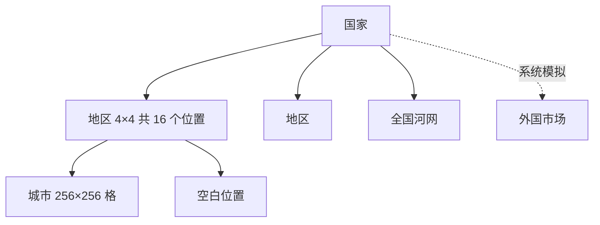

# 游戏设计

本文说明《城市首席规划师》怎么玩：目标和基调、世界结构、城市里的对象、各系统的规则和因果、经济、升级、时间和离线。界面怎么组织见 `ui-map.md`，数据怎么存见 `data-model.md`，分区里长出什么、楼的尺寸和奖励建筑见 `catalog.md`。需求条目在 `docs/product/requirements.md`，这里不重复验收标准。

状态：草稿（2026-11-04），待用户确认。数值（价格、门槛、半径、费率、红线、系数）统一放在 Q-006，这里只写规则和节奏目标；本文写“见 Q-006”的每一处，都是 Q-006 重写时要列入的项。价格整体往便宜里定，让玩家造得轻松。

文中的“天”指现实中的一天，按北京时间计；游戏里的一天写作“游戏日”。“水运”指货船在天然河流上运货，游戏里没有人工运河。极少碰到的情况只写一句怎么处理，不为它加机制。

## 1. 目标和基调

- **一句话**：在一个虚构国家的某个地区里，把一块空地建成繁荣的城市，路网、分区、公共服务和交通都由自己规划，再用铁路、高速公路、水运、航空和海运接进全国和海外的货运网络。
- **长期目标**：一个玩家只经营一座城市，把它越建越大、越建越好。城市等级是进度条，共十级，每级解锁新东西。10 级以后继续经营这座城市，没有终点；想换个地方从头建，可以结束这座、开一座新的。
- **每次打开**：看一眼城市怎么样、钱从哪来、花到哪去，按自己的想法改一两处，放心离开。
- **收入模式**：玩家看激励视频得到好处，不限次数，看得越多开发者收入越多（REQ-027）。游戏里处处有“看一下视频就更好”的时刻，见第 10 节。缺钱时也靠看视频补，不另设免费通道。

| 基调 | 怎么做到 |
|---|---|
| 笃定，不焦虑 | 问题只让发展变慢；楼只会慢慢降到撑得住的档次，不会荒废；地图默认不标红、不飘警告；车流是城市的活力 |
| 自己做主 | 没有强制任务，已解锁的工具随时可用；新手引导只带到 2 级，可以跳过；邻居不玩了，还有水运这条谁也挡不住的路 |
| 各管各的城 | 每个人只造、只拆、只付自己城里的东西；邻居之间靠边界上的接口连起来 |
| 是游戏，不是信息系统 | 数据画在地图上，最多浮小图表和进度条；不用文字解释原因；不弹清单。唯一的例外是城市结束画面上的一行短语 |
| 操作一致 | 升级道路、升级厂、升级机场、提高分区密度都是同一个动作：选另一级的，直接造在原来的上面 |
| 每次打开都看得到变化 | 税每分钟到账，经验条每分钟动，工程几十秒到几分钟完工，每天一次的判定分摊到一天的各个小时；离线期间城市照常长、人照常上学 |
| 每座城市都不一样 | 地形和气候是生成的，河的走向各不相同，路网由玩家画，楼跟着地块形状、气候和城市水平长，专长看得出来 |

## 2. 世界结构

- **国家**：由数量不定的地区拼成不规则的形状，有的地区靠海、有的在内陆，也可能整个地区都在内陆。国家有名字（系统起）和一个国家时钟，同一国家的玩家看到的昼夜和日期一样。海的外面就是外国，外国是系统模拟的外国市场。
- **地区**：4×4 共 16 个位置，有名字（系统起）。地区小，所以同地区的城市大多互为邻居或隔一座城，二星的货不愁没人买。
- **气候**：按地区定。一个国家从北到南跨几个气候带：寒冷、温和、炎热。气候影响楼和树的外观、农田长什么、能造哪些奖励建筑。
- **城市和空白位置**：有玩家的位置是城市，地图 256×256 格。没有玩家的位置只是一片空白，不是城市，不能连路、不买不卖。没有系统城市。
- **位置的标志**：一个位置可以同时有几个标志：沿海、陆路口岸、地区边缘。不能迁城，也不能和别人换位置。
- **位置的平衡**：生成地形时给每种位置配一份差不多的家底，各有长短，没有绝对最好的位置：沿海有海但平地少；口岸能跨地区收过路费但地形起伏大；内陆平地多、矿多；河网汇合处水运过路费多，但平地被河切得碎。
- **河网**：全国一张河网，像一棵分叉的树，流过每一个位置，包括空白位置。每座城市至少有一条能通航的河从城里穿过，并经河网连到本地区的其他城市和别的地区；不要求通到四个方向的邻居。河是地形，谁也拆不掉，桥从河上跨过不挡船。河流跨过地区边界的地方不设口岸，也没有特殊规则：船照常走，货从本城的码头出地区（见第 9 节“内河码头”）。
- **地形由服务端生成**：开放一个地区时，服务端为 16 个位置各生成一次地形，存成文件；手机下载自己和邻居的地形文件，按地形版本缓存，不在手机上生成。不同手机的浮点运算可能差出一格，各自生成会让服务端误拒合法操作。
- **每个位置的地形**要保证：有本气候 10 级专属奖励建筑需要的地形（寒冷要山，温和要湖，炎热要海或大湖），并在水边留出 6×6 的平地给紧挨水面的奖励建筑；相邻两个位置的边界上，每条边都留出足够长的可建地段，接口只能落在这些地段上（见第 9 节）；可建地在允许跨河架桥时连成一片，湖和陡坡不能把它隔断，每一段可建边都能修过去；通航河的每一段每隔不超过若干格就有一处两岸平地、能架桥（见 Q-006）。256 格下的河宽、桥跨、高度层等参数由地形探针定，见第 15 节。
- **口岸**：相邻地区的共享边上有 1 到 2 对面对面的陆路口岸位置，只有这里能修高速公路和铁路跨地区。两边都接好时，这个接口才算地区的出口节点。
- **城市之间**：只有高速公路、铁路、水运、航空能连到别的城市；两车道和四车道只在本市内。

### 位置怎么分配

- **按顺序填最前面的空位**：国家按编号排，地区在国家里按编号排，位置在地区里有一个固定的顺序。新玩家拿到全世界最前面的空位：国家 1 的地区 1 的位置 1、2、3……地区满了填下一个地区，国家满了填下一个国家。有人离开、空出的位置又成为最前面的空位，下一个新玩家填进去。分配时跳过别人正留着的位置。
- **地区里的顺序**：生成地区时定好 1 到 16 的顺序，保证每个新位置都紧挨着顺序更靠前的位置。起点是对着上一个地区口岸城市的口岸位置（这个地区是本国第一个地区时取一个角）；之后每一步，在紧挨已有位置的候选里优先取口岸位置，让口岸早点有人；没有口岸候选时取让一片连得最紧的那个。
- **留位**：分到的位置和看过的位置都给你留 30 分钟，算进每人 3 个留位的上限（和邀请共用，见第 13 节）。取名时分到的位置已被别人占了，自动免费换成下一个空位，顶部写“原来的位置被占了”。
- **看视频换位置**：只能在顺序最前面的约 4 个空位里换（见 Q-006）；换的时候按地形评分加权，换到好地形的概率更高，但不保证。换过以后，预览下面一排最多 3 个最近看过的位置，角上写还留几分钟，点一个免费切回去。
- **被邀请的人**：放在邀请人旁边的位置，邀请发出时就把位置留住，不走顺序。
- **开新城**：也按这条规则分配，看视频换位置时不按地形加权。刚结束的城市腾出的位置也是空位，新城正好落回这里是正常的。
- **新地区开放**：上一个地区 16 个位置都有城市时开放下一个；国家没有地区可开时生成新国家。新地区的第一个玩家暂时没有邻居，按顺序分配，第二个玩家很快就来，不为这段时间加机制。

### 一个人一座城市

- 任何时候每个玩家只有一座正在经营的城市。想开新城，要先结束这一座：任何等级都可以结束，结束时要看完一次视频（见下面“城市的结束”）。
- 新城一律从 1 级开始，不保留等级、经验和资金；只保留玩家的名字，城市名可以沿用上一座的，也可以重起。开局资金按 1 级给。
- 新手引导在每座新城都照常出现，玩家可以手动跳过，第一座城和以后的城一样。新城有保护期（见第 3 节）。
- **升级奖励按玩家只发一次**：一个玩家第一次到某一级才有这一级的奖励；开新城以后再到这一级不再发，反复开城刷不到奖励。
- 两台设备同时点“开新城”，只有一台成功，另一台拿到同一座。
- 好友是按玩家算的，开新城不影响好友。

### 城市的结束和历史城市

- **城市结束的四种情况**：
  - 玩家 30 天没打开游戏；
  - 对着这座城市的线头，在期限内没接好（见第 9 节“和邻居连通”）；
  - 破产保护到期（见第 10 节）；
  - 玩家自己结束这座城市，开新城也走这一步：要看一次视频；广告不可用时直接结束，不限次数。
- 城市结束后，位置变回空白，按“位置怎么分配”留给下一个新玩家；通往这座城市的所有线路断开。邻居修到它边界上的高速线和铁路线留在原处，等新城市过了保护期后算对新城市的请求；邻居为接它造的匝道和货运站留在邻居城里，不算请求。它自己那一侧的接口记录清成“无”，邻居对它的期限全部清掉；邻居正在接它线头的工程自动取消、全额退款。
- 结束的城市都进入玩家的“历史城市”：只保留参观快照，缩略图由手机用快照当场画，只能参观，不能再改。玩家可以随时把历史城市永久删除。玩家 180 天没上线，他的历史城市自动清掉（保留期和 REQ-024 的一致性待核实，见第 15 节）。
- 玩家下次打开游戏时，首页就是这座城市结束的画面：最后一眼的全景、一个表示原因的图标、一行短语（“邻居的线头 7 天没接上”“资金在红线以下过了 12 小时”“30 天没有打开游戏”“你结束了这座城市”），按钮“开新城”和“看历史城市”。玩家没有正在经营的城市，所以不另发站内信。
- **开新城**：没有正在经营的城市时，玩家可以开一座新城市，位置按“位置怎么分配”给，从 1 级、1 级的开局资金和新手引导开始（见“一个人一座城市”）。

## 3. 开局

1. 系统分配位置，下载地形：完全空地，但山、河、湖、森林、海岸齐全，至少有一条能通航的河穿过。取名之前先看这块位置的地形预览：预览画出整块地，胶囊下方靠右一张本地区 4×4 的小缩略图标出这块位置在哪；位置上原来留下的线头画在边界上，标“保护期后要接”。不满意可以看视频换，留位和换位置的规则见第 2 节。被朋友邀请进来的玩家跳过这一步，直接放在邀请人旁边的位置上。
2. 给城市取名：最多 12 个字（表情按一个字数），汉字、英文、表情、符号都可以，只过内容安全检查；检查服务不可用时先用默认名“某某的城市”。开新城时输入框里先填好上一座城市的名字，可以沿用，也可以重起。以后改名时，距上次改名不到 30 天要花钱（见 Q-006），满 30 天免费；改名同样过检查。通过后又被判违规的名字显示成默认名，并给一张必须改名的免费卡片。
3. 开局资金作为第一条入账记录发下来，够修第一批路、划第一批区、造水厂和电厂；哪些钱算经验见第 11 节。没有救济金；缺钱可以看激励视频。
4. 新手引导一步步带，每座新城都出现，可以跳过（跳过要二次确认；设置里可以看一遍引导的演示动画，不能操作）：
   1. 修路；
   2. 造水厂和电厂；
   3. 划住宅和工业（1 级也能划商业，引导里不划）；
   4. 看楼长出来、收到第一笔税；
   5. 升到 2 级。这个玩家第一次到 2 级时，领了升级奖励这一步才完成；第二座城起升到 2 级就算完成，不等领奖，仪式上一行小字“升级奖励在第一座城市领过了”。
   引导结束时镜头拉远，一条船顺着穿城的河开过去，让玩家看到河网把自己和本地区别的城市连起来；码头靠“新”标签提示，3 级有了二星以后才用得上。第一次有线头对着自己时，“去接上”做成一步引导，按玩家只出现一次，开新城以后也不重复。
5. 经验每分钟都在涨；2 级的门槛设成第一次打开大约 10 分钟内能达到，第一次打开就能看到升级仪式。
6. **新城市保护期**：建城起 3 天（见 Q-006，可配置）。这期间邻居不能往它的边界修线头；它的位置上原来留下的线头也不算对它的请求，保护期过了才开始算期限。保护期结束前一天发一封站内信，地图上城市名旁显示保护期剩几天。

## 4. 地图上的对象

| 对象 | 玩家能做什么 | 自己会怎么变 |
|---|---|---|
| 地形 | 可以单独清除森林，按格收费、有工期（见 Q-006）；修东西落在森林上时自动清 | 不变，属于位置 |
| 道路 | 画、换等级、拆 | 不变 |
| 路口 | 新出现时选红绿灯或环岛，以后可以改 | 按规则配信号 |
| 匝道 | 不在菜单里；普通路拉到高速公路边上时自动弹出，方向由系统选 | 不变 |
| 分区 | 用刷子划住宅、商业、工业、农业，同时选密度上限；可以重刷 | 有路有条件时长楼 |
| 楼 | 不能直接造；用推土机点楼拆的是“分区 + 楼”，这也是取消分区的办法；重刷分区或修东西时走征收 | 自己长、升降星和密度、搬空 |
| 农田 | 划农业区 | 一片地，形状跟着地形，不是一栋楼 |
| 公共服务建筑 | 自己选种类、选位置造；落在楼上走征收；可以拆；预算分四项调 | 不变 |
| 垃圾处理用地 | 划出来，相邻的地自动并成一块 | 系统在上面造垃圾场 |
| 水厂、电厂、燃气厂 | 造、换等级、拆 | 不变 |
| 公园 | 用刷子划出来；系统按面积和位置长出小游园、街心公园或湖滨步道 | 不变 |
| 公交线路 | 依次点站，可以画多条 | 按客流运营 |
| 地铁线路 | 画线、放站（站占格） | 按客流运营 |
| 铁路 | 画线、放货运站和客运站 | 运货、运外地客人 |
| 内河码头、国际港 | 解锁后造 | 运货、收过路费 |
| 机场 | 解锁后造，国内机场可以升级成国际机场 | 运货、运游客、收过路费 |
| 奖励建筑 | 解锁后选地方造，每种一座；拆了可以再造，付全价 | 各有作用和副作用，有的带来游客 |
| 车辆 | 不能操作 | 只是画面表现 |

**坡和森林**：楼、设施、站、机场、奖励建筑和路口只放在同一高度的平地上；路和铁路过坡按 ADR-0001 的坡度规则。分区可以刷在坡上，但坡格不长楼，刷子预览里画淡；农田可以盖缓坡，茶园、果园、牧场在缓坡上更容易长。修路、划区、造设施落在森林格上时自动清掉，造价和工期加上按格算的清森林费用和时间，预览的总价里含这一项；划区的森林格在长楼时才清，费用划区时就收。

**换等级都是同一个动作**：在建造菜单里选另一级的东西，直接造在原来的上面。往高一级：只补两级之间的差价，工期按差价对应的那部分算；往低一级：也可以，不退差价，工期按新造。新的完工之前，旧的照常使用，水电、道路、连接都不断；中途取消时旧的还在。占地变大时，多出来的格子上的楼走征收。换一种厂（比如火电换成风电）也是直接造在原来的上面，按新造算钱。

**征收**：先预览要拆几栋、影响多少人，确认后这些楼慢慢搬空拆除。征收本身不花钱，代价是搬空期间少了这些楼的人口和税。造在楼上时，工程和搬空同时开始，完工 = 开工 + max(工期, 搬空时长)；看视频加速时两者一起完成。

**拆除**：在拆除模式里点一下只是选中，路段或建筑高亮，弹出卡片才确认。拆除免费，资金为负时也能拆。确认后进入“拆除中”：10 秒内可以撤销，这 10 秒里它照旧存在、照旧起作用（住户、员工、覆盖都不变），10 秒过后移除；拆除本身不另算工期。撤销就是改回在用。拆的路段会让某个接口变成没接好时（用本地路网算），卡片上画出拆了以后的样子，分三种：对方有线头，或者两边接好过、对方的匝道或货运站还在（算对着你的请求，见第 9 节），你这边亮起 7 天期限；对方什么都没修到边界或对面是空白，接口消失；对方正在接你的线头，对方完工后你要接回来。这三种确认按钮都要按住约 1 秒。拆修到边界的那一段、撤销线头，都要联网由服务端当场确认，没网时置灰。

楼长哪一类、哪个品种、用哪套造型、占哪块地，用“城市种子 + 楼的编号 + 第几次生长”作为随机种子，结果写进存档，换手机和别人参观时都一样。

### 工期

工期按服务端时间算。手机按“服务端时间偏移 + 单调时钟”记开工时刻，没网时也照样开工，同步时上报；服务端把它夹在“上次同步时刻”和“这次收到时刻”之间，作为认定的开工时刻。修到边界、接线头这类要当场确认的，开工就是服务端收到的时刻。完工时刻 = 开工 + 工期 − 视频加速；拨手机时钟不能提前完工；手机上已经完工的不回退。玩家造的东西可以看视频加速：剩余不到 30 分钟的立即完成，否则减去 30 分钟，不限次数。自己长的楼不能加速。

| 玩家造的 | 工期 |
|---|---|
| 两车道、公园、公交站和公交线 | 5 到 15 秒 |
| 四车道、匝道、垃圾处理用地 | 30 秒 |
| 一级厂、派出所、消防站、小学 | 30 秒 |
| 医院、中学 | 3 分钟 |
| 二级厂 | 5 分钟 |
| 三级厂 | 20 分钟 |
| 内河码头 | 5 分钟 |
| 高速公路（地面）、铁路线、地铁线 | 每 8 格 1 分钟 |
| 高架 | 每 8 格 1 分钟，再加 10 分钟 |
| 铁路货运站、铁路客运站、地铁站 | 10 分钟 |
| 立交 | 30 分钟 |
| 国内机场 | 2 小时 |
| 国际机场、国际港 | 4 小时 |
| 奖励建筑 | 2 到 4 级解锁的 10 分钟；5 到 7 级的 1 小时；8 到 10 级的 3 小时 |
| 清森林 | 每格几秒，见 Q-006 |
| 拆除 | 不另算工期，确认 10 秒后移除；免费 |

| 自己长的 | 工期 |
|---|---|
| 新楼（都从低密度起步） | 1 分钟 |
| 升降星和密度的重建 | 按重建后的密度：低密度 1 分钟，中密度 3 分钟，高密度 6 分钟 |
| 征收和断路后搬空 | 2 分钟 |

开工时一次付清；确认后 10 秒内可以撤销并全额退款；在建的可以取消，退回没建那部分的钱。退款冲减支出，不算新进账的钱；服务端只认它见过“在建”又取消的退款。工期超过 10 分钟的工程完工时发一封通知类站内信（见 Q-006），更短的只在工地上闪光。

## 5. 道路和交通

### 道路

| 等级 | 解锁 | 特点 | 楼能开门 | 能修到边界接邻居 |
|---|---|---|---|---|
| 两车道 | 1 级 | 最便宜，左转和直行同一个绿灯 | 能 | 不能 |
| 四车道 | 2 级 | 有左转专用道和左转灯 | 能 | 不能 |
| 高速公路 | 7 级 | 只从匝道和立交进出；可以修在地面或修成高架，高架贵但不割断城市，高架下面只能有道路，不能有楼和设施 | 不能 | 能，也能经口岸跨地区 |

- 画路：手指拖动，自动吸附八个方向；松手预览造价、要征收的楼和要清的森林，确认才造。手势见 `ui-map.md`。
- **路口**：线和线按线段相交判断；斜路在两个对角格之间穿过另一条路时，交点吸附成一个路口（铁路是道口，碰到高速是跨线桥或立交）。3 到 4 条路默认红绿灯，5 条以上默认环岛，玩家可以改。只有隔 1 格的两个路口合并成大路口。
- **贴路**：楼或设施和路共一条边就算贴路；斜路两侧和它共边的格都算临路。
- **匝道**：把两车道或四车道拉到高速公路边上，顺着高速或垂直于高速，松手时自动弹出一个匝道把两条路接上。匝道是几种固定模板（顺向入口、垂直接入，各分地面和高架），按松手方向选；落在楼上走征收，碰到水和陡坡时虚影变灰、不弹出。匝道不在菜单里，几级都能接，包括邻居修到边界、自己还没解锁高速公路的城市。两条高速公路相交时用几种固定的立交模板。
- **高速和别的路怎么交叉**：高速公路不和任何东西平交。普通路或铁路画过地面高速时，自动修一座跨线桥，按桥的价格收钱；高速画过普通路时同样。
- 两车道：一个方向一条车道，左转车在路口内等对向空档，后车排在它后面。
- 拆路让楼失去门口的路时，先预览；确认后这些楼慢慢搬空拆除，分区保留。
- 城里的高速公路、匝道、两车道、四车道是同一张路网。

### 铁路

- 3 级解锁。和道路一样走八个方向，过坡、过河同样处理；和道路相交处做平交道口，和地面高速相交处做跨线桥。
- 铁路有两种站，都在建造菜单里：
  - 货运站：本城的货从这里装车；别的城市的货穿城而过不需要站。接邻居铁路线头的货运站可以直接造在边界旁，不需要先有自己的铁路线。
  - 客运站：外地客人可以坐火车来，来的人更多、不占道路。客运站只有在接好了至少一个邻居的铁路网上才起作用：远途游客要有这样的客运站或机场，购物客坐火车来也要它。孤立的一格铁路上放客运站没有作用。
- 铁路能修到边界接邻居，也能经口岸跨地区。铁路和路网是两张网；铁路和水运的货不进路网。

### 车流

- **组成**：上下班、本市居民购物、外地客人（游客和购物客）、本城出货（工业和农业把货运出城）、过境货运，再加上公交车。过境货运由服务端按“从哪个接口进、从哪个接口出、多少”下发给城市；外地客人从高速公路和铁路的接口、客运站和机场进城。
- **单位**：负荷一律按“每游戏日的标准车次”记，路段容量按“每车道每游戏日”。开车上班的人每天 2 车次；居民每天的购物车次按收入星级给；外地客人每若干人 1 车次，坐火车和飞机来的只算从车站、机场到目的地这一段；一单位货折成若干辆货车，一辆货车顶 2 辆小车；一辆公交顶 10 辆小车，每条线每天的公交车次 = 这条线最挤一段的客流 ÷ 每车载客，向上取整。系数见 Q-006。
- **交通小区**：地图按 16×16 格分成交通小区（256 格的地图共 256 个）。每个游戏日把各部分车流汇总成小区到小区的出行表，做三轮逐次平均分配：每轮按当前通行时间给每对小区找最快的路，把这一轮三分之一的车流加上去，再更新通行时间。三轮分摊到当天第 0 到 7、8 到 15、16 到 23 个游戏小时里做，当天用前一天的结果。
- **出行表**：每天第 0 小时建一次，三轮共用。上下班从住宅所在的小区到公司所在的小区。居民的购物车次从住宅所在的小区出发，按全城同星级商场的岗位分布摊到各小区。外地客人从进城的接口、车站或机场所在的小区出发，按商场和住宿文娱的规模摊到各小区。出货从工厂和农田所在的小区出发，按上一次地区结算里本城各接口和设施的货量比例摊到它们所在的小区；走铁路和水运的只算到货运站或码头这一段。过境货运从进城接口所在的小区到出城接口所在的小区。公交车次不进出行表，直接加在线路经过的路段上。同一小区内部的出行不上路网。
- **通行时间**：路段时间 = 每格通行时间 × 格数 × 拥堵系数，拥堵系数按“负荷 ÷ 容量”算、有上限。路口按类型有容量（两车道红绿灯、四车道红绿灯、环岛、匝道、立交），路口负荷是进入它的各路段负荷之和，延误 = 基础延误 × 拥堵系数。一段行程的时间 = 路段时间 + 经过的路口延误。两车道的左转让行和四车道的左转灯，在模拟里只体现为路口容量不同；交通指挥中心把全部路口的容量乘 1.15。数值见 Q-006。
- **通勤时间**：每组上班的人的通勤时间 = 家门口到所在小区 + 小区到小区 + 小区到公司门口，每天分配完更新一次。“最近的空岗位”按路网距离找。通勤超过 45 分钟（游戏内）扣住户满意度。
- 路段负荷、路口负荷和小区之间的时间表进存档，打开游戏时不重算。当天的出行表和已经加上去的轮次负荷也进存档，重新打开游戏时接着做剩下的轮次。离线补算完做的那次分配当作前一天的结果，当天剩下的轮次不做，到下一个第 0 小时重新开始。
- 拥堵影响通勤时间（扣住户满意度）和路边的尾气（扣路边楼的环境，拥堵的路口也算），两者不重复。过境车流也算进负荷，它对满意度的影响系数调到小于过路费的补偿（见第 9 节）。
- 画面上的车只给视野里的路段按负荷生成，按红绿灯行驶，只是表现，不回写模拟。

### 公交和地铁

- 玩家不收票价，只花维护费，维护费按站数和线路长度算。
- 公交站不占格子，依次点站，系统沿最短的路连起来；点回第一站就是环线。公交线不走高速公路和匝道。玩家不管车辆数，坐的人越多，路上公交车越多，算进道路负荷。公交和小车一起堵，没有公交专用道。
- 地铁在地下，线路可以从楼下穿过，但经过的楼环境减分；站占格子，落在楼上时走征收。一条线是一根线或一个环，不分叉；两条线相交的站是换乘站。地铁不堵。
- **坐车的时间**：步行到站 + 等车 + 坐车 + 换乘 + 步行到公司。等车时间按方式固定，不随客流变；可以换乘，每次加固定时间；公交按所走路段前一天的拥堵时间算，地铁按每格固定时间算。比较时用家和公司各自步行范围内最近的站。数值见 Q-006。
- **坐不坐**：人人都有车。家和公司都在站点步行范围内的人，比较“坐车”和“开车”两条路的“时间 + 花费”：开车的花费是油费（按距离）加停车费（目的地密度越高越贵），公交只有车票；花费折算成时间时，收入越低的人折算系数越大，所以时间差不多时低收入住户更倾向公交（见 Q-006）。票价、油费、停车费只用于这个比较，不是玩家的收入。每个游戏日重新比较，坐车的比例每天向目标移动一部分，渐进变化。

## 6. 分区、楼和人

### 分区

- 住宅、商业、工业各有低、中、高三种密度刷子，玩家划区时就定了密度上限；农业一种。密度越高，每格越贵。划区本身收费，算进支出。
- 刷子从一点拖到另一点拉出轴对齐的矩形，只留离路不超过刷子深度的格子，刷子深度按分区类别定（见 Q-006）；离路的距离按到最近路格的切比雪夫距离量，斜路旁也一样。楼必须贴着路，出入口在路边，车从出入口进出门口那条路。
- 同类分区往高密度重刷只补差价，楼慢慢重建；往低刷不退钱。换成另一种分区，按新分区的价格全额收费，原来的楼走征收。

### 分区的需求

拿起刷子时屏幕边上浮出四根需求条，长短表示需求，楼长不长也看它：

| 分区 | 需求从哪来 | 折成“还缺多少格的楼” |
|---|---|---|
| 住宅 | 全城空岗位数 + 一个按等级定的基础值；满意度“很差”时为零 | ÷ 每格住宅的平均人数 |
| 商业 | 居民和外地客人的消费减去已有商场的规模；办公的需求按本市、本地区、全国、外国的公司岗位数算，不把办公岗位本身算进去 | 没满足的消费 ÷ 每格商场的服务量 |
| 工业 | 各类货上一次的需求系数 × 富余的工人；需求系数有下限 0.1，新解锁的档位也长得出来 | ÷ 每格工业岗位数 |
| 农业 | 农产品的需求系数 × 可划农田的空格数 | × 系数 |

- 缺的格数再乘税率系数（低、正常、高三档）：税高、缺工人、缺顾客时条变短。
- 条长 = 缺的格数 ÷（缺的格数 + 一个按等级定的常数），在 0 到 1 之间。
- 每个游戏小时，每类最多开工 ceil(条长 × 每小时上限) 栋新楼，上限按等级。
- 长在哪：在有水有电、贴路的空分区里，只在放得下这一分区最小尺寸的格子里挑，按“离已有同类楼近、环境分高”打分，同分按格子编号取。系数和上限见 Q-006。

### 楼的占地

- 分区不预先切地块。长新楼时，在选中的那一格上找一块矩形：包含这一格、一条边贴路、全在同一高度的平地上，尺寸按类别和这块分区的密度上限取自尺寸表，用楼的随机种子在放得下的尺寸里挑，偏向大的；挑尺寸和摆法的细则见 `catalog.md` 第 2 节。放不下最小尺寸的零碎格留空。
- 门开在贴路的那条边；两条边都贴路时，开在等级高的路上。
- 斜路旁边，矩形里只要有一格和斜路共边就算贴路，门开在这一格朝路的边上，尺寸表的宽和深可以对调。
- 新楼从低密度起步，以后在原占地上逐档升到分区的密度上限；密度升降在原占地上重建，不改占地。
- 农田按同一规则长，尺寸更大（4×4 到 8×8），也要和路共边。
- 尺寸表的目标：256 格满城不超过约 1 万栋楼（见 Q-006），画面和模拟都按这个数做性能验收。

### 楼的两条属性

| 类型 | 密度 | 星级 |
|---|---|---|
| 住宅 | 住多少人 | 住户的收入，1 到 4 星 |
| 商场 | 规模 | 顾客档次，1 到 4 星 |
| 办公、工业 | 公司规模，能用多少员工 | 卖多远，1 到 4 星 |
| 农业 | 一片地的面积 | 1 到 2 星，农业科技园后到 3 星 |

- 办公和工业的星级代表卖多远：一星销往本市，二星本地区，三星本国，四星出口海外。商场的星级代表顾客档次。界面只显示星，不写名字；点楼时一句描述，比如“销往某某地区”。
- **四个市场档**：本市、本地区、全国、外国，分别对应一到四星。一家公司的货先卖本市，剩下的进本地区，再进全国，再进外国；每个档各有一个售出比例（见第 9 节）。
- **实心星和空心星**：某一档卖出的比例超过门槛（见 Q-006，建议 20%）才算这一档实心；有本事但没通道或没需求的是空心星。比如四星办公没有国际机场，就显示两实两空。空心星旁边画一个灰色图标，表示缺的那种通道（铁路、船、飞机），点它打开建造托盘里对应的卡片。本市总能卖，所以只要本市有人买，至少是实心一星。
- **计税星级**：各档卖出比例 × 该档星级之和，是一个带小数的数，商业和工业交税用它，可以接近 0。商场没有市场档，计税星级 = 售出比例 × 商场的星级。**最高实心星**是整数，住户的收入星级用它。
- **岗位按星级分**：一家公司的岗位按配置比例分到一星到公司星级（例如三星公司一、二、三星各 30%、30%、40%，见 Q-006），升降星时按新比例重分。服务端核岗位用同一份比例。
- **住户收入**：每个上班的人的收入星级，等于他所在公司的最高实心星（公司一颗实心星都没有时按一星算），再按这栋楼的环境上限取低：环境只够二星的楼，住户收入按二星算，不是住不进去。一栋住宅的外观星级是人数最多的那一档，平局取高；外观按最近 3 个游戏日的平均定，升降后至少保持 1 个游戏日，不来回跳。交税按各组住户分别算（见第 10 节）。高收入的人可以住市中心高楼，也可以住郊区别墅。

### 商业、工业、农业

具体目录见 `catalog.md`，这里只写规则。

- **商业**：一种刷子，系统按需求决定长哪一类。全城商场不够居民和外地客人消费时先长商场；市中心和地铁站旁更容易长金融科技。市中心是岗位最多的 3×3 个交通小区，每个游戏日算一次。
  - 商场（零售、餐饮、生活服务、住宿文娱）：按顾客收入分档。每档收入的居民先在同星级的商场消费，满了往低一星溢出；一星居民只去一星商场。购物客和短途游客去二星以上的商场；远途游客先去四星住宿文娱，满了再往下溢出。售出率由手机按全城算，不按路网分片。
  - **商场的星级跟着顾客走**：升星除了人才和税率，还要求高一档顾客的消费在高一档商场里有剩余（剩余比例见 Q-006）；某一档的商场连续 3 个游戏日售出比例低于实心星门槛，降一星。没人买的高星商场会降下来，不会占着位置让商业税归零。
  - “就近有商场”按路网距离看住宅门口几格内有没有商场（见 Q-006）。
  - 办公（商务服务、金融科技）：按星级卖得远，要有通道：二星要连上本地区至少一座别的城市（高速公路、铁路或水运），三星要能出地区（口岸、水运或机场，国内机场也算），四星要有国际机场。通道可以借用连得到的城市的出口节点。机场只运哪些货的限制只管货，不管办公。走水运的办公服务同样打折。商业不运货，沿途城市收不到它的过路费。
- **工业**：五类（矿产、建材、工业品、消费品、高科技），长哪一类受需求、地形、星级、周围同类、附近农田、环境和奖励建筑影响。污染按类别算。卖出本地区要能经口岸、水运或机场连到别的地区；卖到国外要有国际机场或国际港。原料（矿产、工业品、农产品）只算成需求，缺原料不限制生产。
- **农业**：十类，跟着地形和气候长；农田产的都算农产品。岗位少、税低、基本无污染，可以挨着住宅；只要水。

### 人从哪来、去哪上班

- 人口只算搬进搬出：每个游戏小时按满意度和空房决定搬进多少，按住宅满意度从高到低填空房；满意度“很差”的住宅有人搬走，先走未分配的。不模拟出生、死亡、退休。
- 新居民自带学历，比例随城市等级提高：低级城市搬来的多是没上学和小学学历，等级越高，中学、大学学历越多。造了人才中心后更高。
- 上班有一张分配表：一栋住宅按去哪上班、什么学历分成几组，例如“60 个中学学历的人去工业 A”。同一住宅、同一公司、同一学历的自动合成一组；每栋住宅最多对应 8 家公司（见 Q-006）。
  - 写下的分配一般不变，新开更近的公司不会把人吸走。
  - 新增的人和失去岗位的人变成“未分配”，每个游戏小时去找学历对口、路网距离最近的空岗位；已有组的公司距离不超过最近空岗位的 1.5 倍时，优先进已有组。没有对口的就找低一档的；再没有就是失业。失业就是这一小时没找到工作的未分配，不另设状态。新划的工业区几分钟内就有人来上班。
  - 公司升星时，学历够的员工直接留下，不够的变回未分配；降星时多出来的员工变回未分配。
  - 每个游戏日，一部分屈才的人（学历比岗位高）换到更高档的空岗位，一部分通勤超过 45 分钟的人换到更近的同档空岗位；按住宅的编号分摊到一天的各个小时。
- 不跨城通勤。

### 外地客人

外地客人只算成数字，不追踪个人。由服务端在地区结算时用城市摘要算，和售出率一起下发：

- **游客**：奖励建筑的吸引力之和 × 交通连通程度。短途游客看用高速公路和铁路连通了几个邻居；远途游客要有起作用的铁路客运站或机场。水运不算游客的连通。去住宿文娱和商场消费。
- **购物客**：按用高速公路和铁路连通的邻居的人口，和本城二星商场的份额估算，有上限（公式见 Q-006）。去二星以上商场消费。
- 外地客人增加商业的需求和税，也带来车流。

### 教育和人才

- 每栋住宅记各学历的人数：没上学、小学、中学、大学。
- 每个游戏小时小步推进：有小学覆盖时，没上学的人慢慢变成小学学历；同时有小学和中学覆盖时，小学学历的人慢慢变成中学学历；有大学时，中学学历的人慢慢变成大学学历。三段按没上学到小学、小学到中学、中学到大学的顺序算，后一段用前一段升完后的人数。每小时的升学比例见 Q-006。
- 升了学的人在分配表里：先升未分配的，不够再按各组人数比例升（最大余数法取整）。升了的人留在原公司，组按学历拆开，等每天的屈才换岗再换到高档岗位。
- 升学有上限，按全城算：小学普及；中学最多约七成，图书馆再提高约 5 个百分点，并让中学升学稍快一点，造好就看得到效果；大学最多约两成。全城上限不够时，这一段各楼应升的人数按同一比例缩小，用最大余数法取整，余数相同时按楼的编号。上限只管升学，不管新居民自带的学历。学校预算只改满意度，不改升学速度。
- 离线期间照常上学：学历跟着现实时间走，离开多久就补多久，不受离线补算的天数上限约束（见第 12 节）。
- 节奏目标：有小学覆盖后，约 1 小时大部分人升到小学学历；中学约 4 小时接近上限；有大学后约 12 小时接近上限。按现实时间算，离线也算。
- 岗位要学历：一星谁都能做，二星要小学，三星要中学，四星要大学。造了职业技术学院后，没上中学的人也能做三星工业岗位。
- 全城按学历分档算劳动力。“富余的人”包括这一档及以上学历中，未分配的人和屈才在低档岗位上的人。公司升星前要确认有富余；人才变少时，楼慢慢降到人才撑得住的档次，不会荒废。
- 高学历的人可以做低档工作；学历比岗位高两档以上才扣满意度，高一档不扣，所以 6 级造大学不会让大学生做三星岗位时变得不满。低学历的人做不了高档工作。

### 升降星和密度

- 城市等级定星级上限：

| 等级 | 住宅、商业 | 工业 | 农业 |
|---|---|---|---|
| 1 到 2 | 1★ | 1★ | 1★ |
| 3 到 4 | 2★ | 2★ | 2★ |
| 5 到 7 | 3★ | 3★ | 2★，有农业科技园 3★ |
| 8 | 4★ | 3★ | 同上 |
| 9 到 10 | 4★ | 4★ | 同上 |

- 8 级的四星先靠住宿文娱（远途游客）拿到实心星；四星办公要等 9 级的国际机场。
- **每天的轮转判定**：每个游戏日每栋楼判定一次，按楼的编号分摊到一天的各个小时，每分钟都有楼在判定。星级和密度一起判，一次只升降一档，升降后至少保持 1 个游戏日。判定时从全城人才池里扣，同一小时里的楼不会一起用掉同一批人。
- **星级**：人才够、税不高时升一星（商场还要看顾客，见上面“商业”）；条件变差时慢慢降。通道只决定星是实心还是空心。楼升降星时拆掉重建成新的样子。
- **密度**（不超过分区的密度上限）：
  - 住宅：满意度“好”以上、住宅需求条大于 0 时升；“差”以下时降。
  - 商业和工业：需求条大于 0、对口的富余工人够、这一类税率不在高档时升；计税星级连续 3 个游戏日低于 0.5 时降。
- 离线回来时，离线期间升了星的楼在地图上闪一下。

## 7. 满意度和环境

- 每栋住宅各算各的满意度，每个游戏小时刷新，全城按人口加权平均。界面用表情和颜色，分五档，不显示分数；“很差”是五档里最低的一档。
- **怎么合成**：各项分相加，得到这栋住宅的目标值；满意度每小时向目标值移动三成，用四个门槛分成五档。组成：公共服务、水电燃气、垃圾、通勤、环境、工作（失业、学历和工作是否对口）、就近有商场、住宅税率，以及奖励建筑的加分。全城环境加分和全城满意度加分各有总上限；减分不受上限。分值和门槛见 Q-006。
- **新解锁的服务有等待期**：小学、中学、警察、消防、医院、垃圾、燃气七项服务和“就近有商场”，解锁后（就近有商场从建城起）要等玩家在这座城市在线累计 3 个游戏日（现实 72 分钟）才开始算缺，之后 1 个游戏日内逐步计满（见 Q-006）；等待期内这一项按 0 分。离线的时间不算，升级后离开再回来，城市不会一下子变差。水和电从 1 级就有，没有等待期。燃气不挡楼长，只扣满意度。
- 环境：公园、水边、森林加分；高速公路、铁路、机场的噪音减分；工业污染按类别减分；紧挨拥堵道路的尾气减分；地铁从楼下经过减分。污染、噪音、尾气各有半径，按距离线性衰减（见 Q-006）。一栋楼的环境取占地格的平均。环境、噪音和污染只在本城计算，不跨城市边界。
- 满意度的作用：决定搬进搬出；决定住宅能不能升密度；经验按满意度加倍。楼的环境决定住户收入的上限（见第 6 节）。
- 第一版警察、消防、医院只影响满意度，不做犯罪、火灾、疾病；灾害以后做（REQ-031）。

## 8. 公共服务和公用事业

### 公共服务

- 五种：警察、消防、医院、小学、中学。玩家自己选种类、选位置造，落在楼上走征收，可以拆。
- 设施要有一格和路共边才起作用，没连路时在地图上闪。
- 覆盖：服务半径固定，以占地中心按直线距离画圆，楼的中心在圆内就算覆盖。每栋楼对每种服务只有“有”和“没有”，不算容量。
- 学校有先后：中学只对已经有小学覆盖的住户起作用。缺学校分三种状态：没有学校、只有小学、都有。
- 预算：警察、消防、医院、学校各分高、中、低三档，只改变花多少钱和满意度加多少，不改变半径，也不改升学速度。
- 公共服务视图里，没覆盖的地方在地图上直接显示出来，玩家一看就知道该往哪放。
- 维护费分两部分：固定的一部分，和按覆盖人口算的一部分（见 Q-006），所以城市越大花得越多，后期钱不会只进不出。

### 垃圾处理

- 一种单独的用地，连上路就能处理全城的垃圾，不分片、不管距离；能处理多少人由面积决定，人多了在旁边接着划，相邻的地并成一块。垃圾场本身有污染。
- 处理不过来时不挑楼：全城每栋住宅按“没处理到的人 ÷ 全城人口”同样扣分。

### 水、电、燃气

- 住宅要水、电、燃气；商业和工业要水、电；农业只要水，温室还要电。
- 每栋楼只有“有”和“没有”。管线沿路自动接通，按路网分片：城里的路分成互不相通的几片时，每一片要有自己的厂，别的片的厂供不过来。
- **容量和用量**：每栋楼的用量 = 占地格数 × 密度系数（低 1、中 2、高 4），厂的容量用同一个单位（见 Q-006）。一片路网里同种厂的容量相加，楼按到最近厂的路网距离由近到远供，供完为止；离厂最远的先停。
- 厂分三级，级别越高容量越大、占地越大：一级厂 1 级就能造，二级厂 5 级，三级厂 6 级。换等级按第 4 节的统一动作。
- 电厂分火电（便宜、有污染）和风电、太阳能（贵、干净，5 级解锁）：风电只能造在丘陵和海边，太阳能哪里都能造但占地更大；两者供电量一样。水厂要挨着河、湖、海；不挨水面的地方造贵的地下水厂，地下水厂也分三级，解锁等级和普通水厂一样。燃气厂 4 级解锁。
- 断了水电的楼：满意度大降，慢慢降档；新楼在没水没电的地方长不出来。燃气例外，见第 7 节。

## 9. 货运、需求和过路费

玩家不管贸易，不设配额。楼自己生产。卖出本市一定要有交通连通，没有铁路、高速公路、水运或航空就卖不出去。

### 谁来买

货和办公服务的需求只按类别算，不分星级；星级只决定能卖多远、按几星交税。三星的消费品和一星的消费品满足的是同一份消费品需求。商场例外，按顾客收入分档（见第 6 节）。

| 货 | 买家 |
|---|---|
| 农产品 | 居民吃的；消费品里的食品类工厂 |
| 矿产 | 建材和工业品工厂；本市卖剩的矿产由系统按一星价收购（二星卖剩的也按一星价），不需要交通连通 |
| 建材 | 本市和连得到的城市最近几天的净建造支出（扣掉退款）；少量居民 |
| 工业品 | 消费品和高科技工厂 |
| 消费品 | 居民，按人口和收入星级 |
| 高科技 | 三星以上收入的居民；办公公司 |
| 办公服务 | 本市、本地区、全国和海外的公司，按岗位数 |
| 商场 | 本市居民和外地客人 |

- 空白位置没有需求。
- **单位**：所有供需都按“每游戏日的货量单位”记。供应 = 在岗人数 × 每岗日产量（按类别和星级）；农田 = 面积 × 每格日产量，农业科技园再乘系数。需求：消费品 = 各收入档居民数 × 每人日需求；高科技 = 三星以上收入居民 × 系数 + 办公岗位 × 系数；建材 = 最近几天的净建造支出 ÷ 建材单价；原料（矿产、工业品、农产品）= 下游工厂在岗人数 × 每岗原料系数；办公服务 = 公司岗位数 × 系数。手机每个游戏小时按日量的 1/24 结一次，上报和服务端结算都用日量。系数见 Q-006。

### 谁来算

- **本城内部全部由手机算**：本城的需求先买本城的货，从低星买起，高星的留给更远的买家；商场按第 6 节的顾客规则算出售出率。矿产卖剩的部分在这一步按系统收购价算。手机按“类别 × 星级”上报剩下的供应，按类别上报剩下的需求。服务端缺住户收入等输入，不重算这一步：剩下的需求采用手机上报，服务端把它夹在 0 到按已核数据算的本市最大需求之间；本市这一档的售出率只封顶，不超过 min(1, 本市最大需求 ÷ 已核供应)，封顶值存在已核数据里。
- **城市之间由服务端算**：服务端每个游戏日按地区算一次，只分配各城上报的剩余部分。
- **分配的先后**：剩下的二星及以上进本地区，按产量比例分；本地区还没卖掉的三星及以上进全国需求；全国还没卖掉的四星进外国市场。各档的售出比例按这个顺序算出来。
- **地区内**：本地区里经公路、铁路或水运连得到的任何一座城市都是买家，不只是四个相邻的。按各城市真实的穿城路线选路，剩下的需求在同一个市场里按产量比例分，大家的售出率一样。路线经过的每座城市按货值分过路费。
- **出地区**：货只算到出口节点（两边都接好的口岸接口、内河码头、机场、国际港），在那里按全国需求和外国市场卖掉，不再穿过别的地区收费。
  - 全国需求是别的地区上一天剩下的需求之和。服务端每个游戏日按国家汇总一次，按各地区上一天剩下的、能到出口节点的三星及以上供应切份额；地区内各城市再按同样的比例分。地区结算一律用已写好的最新一份国家汇总，不等。被跳过结算的地区，剩下的需求按零算。只有一个地区开放时，全国需求是零，三星的货只能等别的地区开放；内测的规模和机器人城市见第 15 节。
  - 外国市场由系统模拟：每类货有一个需求上限，按国内有国际机场或国际港的城市数增长（见 Q-006），同样按份额分给各地区；目的地用虚构国名显示。
- **离线的城市**：这座城市超过 8 小时没同步（“在市场里”，见第 12 节）时，供应不参与分配，需求照常计入；货照样可以穿过它，但它没有过路费；这一天的结算结果里不写它。地区里还有 8 小时内上过线的城市，这一天就照常结算；一座都没有才跳过。

### 售出率

- 每座城市每个“类别 × 星级 × 市场档”得到一个 0 到 1 的售出比例；把各档加起来就是这个“类别 × 星级”卖掉了几成。售出率只是参数，不是钱：税在手机上按它打折，实心星和空心星也由它决定。
- 住宅不卖货，售出率按 1 算。
- 走水运卖出去的那部分按水运折扣计入售出率；经港口出口的部分按港口折扣，经机场的按机场折扣，港口折扣比机场小；走铁路、高速公路不打折。水运折扣明显大于穿过一两座城市的过路费，这样有陆路时陆路划算，但水运永远值得用（见 Q-006）。
- 新解锁的档位在第一次地区结算前，用本地区这一档上一天的平均值；没有就按空心算。
- **平滑**：手机上用的售出率，取这座城市参与过的最近 3 次结算的平均（见 Q-006），不够 3 次就用已有的几次；没参与分配的日子不算进去，所以离开超过 8 小时回来，不会满屏空心星。邻居结束或拆路时税慢慢降，不是一天掉到底。
- 离线时、以及回来后第一次同步之前，沿用最后一次的售出率。
- 拥堵只计入选路的代价，不单独影响收入。
- 造了物流园的城市，过境的货选路代价更低，本城出货的选路代价也更低。

### 运输方式

- **选路**：选路的代价算上过路费、拥堵和折扣，所以有铁路、高速公路或航空能走时优先走它们，水运是没有别的路时的保底。
- **穿城**：货穿过一座城市时，要在这座城里的同一张网上从一个接口走到另一个接口。路网和铁路是两张网，过境的货不在中间城市换车。比如 A 的高速公路接进 B，在 B 下匝道走一段地面路，再上 B 通往 C 的高速公路，A 和 C 就是连通的；B 收公路过路费，但地面路慢、会堵，路线代价比全程高速高。A 的铁路进 B、再从 B 的高速公路出去，不算连通。过境货走地面路挡不住，过路费就是补偿；铁路没有货运站以外的出口，所以铁路过境挡得住。
- **穿城的拥堵**：服务端在已核路网上算不堵时的代价，再乘手机为这条穿城路线上报的拥堵系数。手机在自己的路网上按前一天的通行时间找这两个接口之间最快的路，系数 = 这条路的通行时间（含路口延误）÷ 同一条路不堵时的时间，夹在 1 到上限之间（见 Q-006）。穿城路线只有这一个数采用手机上报。
- **过路费**：由系统支付，不从卖家的税里扣。每类每星的货有一个单位货值，费率按铁路、公路、水运、航空分别定，每过一座城约货值的 5% 到 10%（见 Q-006）。过路费只是零头：一座城一个游戏日收的过路费不超过“每小时平均税收 × 24 × 10%”（见第 10 节和 Q-006），超出的部分不发；按平时的平均税收封顶，离开几小时的城市照样拿得到。城市收入主要靠税，邻居结束拖不垮它。结算时过路费先记在城市名下，这座城自己同步时满 1 小时（或进入游戏后的第一次同步）合成一笔入账。穿过别人城市的货，按他城里真实的路走；他拆了路，路线就断，系统改走别的城市。
- **内河码头**：2 级解锁，造在本城任何一段能通航的河边。有码头的城市就能沿河把货卖给本地区任何有码头的城市，什么货都能运；中间经过的城市什么都不用造，按水运费率收过路费；经过空白位置时照样能走，空白位置不收费。出地区时码头就是出口节点，所以水运过路费只在地区内收；河跨过地区边界的地方不设口岸。水运谁也挡不住，但卖得便宜（见“售出率”）。1、2 级只长一星的楼，一星只卖本市，所以码头要到 3 级有了二星以后才有货可运。
- **机场**：分两级，升级直接覆盖。国内机场（8 级）不飞本地区，只飞别的地区，运高科技、消费品和远途游客；它也是办公服务出地区的出口节点。国际机场（9 级）再加飞国外，能运所有货。
- **国际港**：10 级，只能造在海边，只通外国市场，没有国内海港；内陆城市没有国际港。港口的出口折扣比机场小，所以国外的货优先走港口。
- 周边城市的货从你的码头、机场、国际港出去，你收过路费。
- **外国市场**：系统模拟，固定需求上限，目的地用虚构国名显示。

### 和邻居连通

邻居之间靠边界上的接口相连。界面上没有“发起请求”“同意”“撤销”这些按钮，只有修和拆。

- **线头就是请求**：一条高速公路或铁路修到边界、对面还没接上，这个线头就是对邻居的请求。线头从修到边界的那段完工时算起；对方可以提前接在建的头，完工后自动算接好。谁先修到边界，接口位置就由谁定。空白位置不能修过去。只有高速线和铁路线算请求；匝道和货运站单独对着别人时不算请求。两边接好过的接口，一方拆掉自己修到边界的那段以后，对方留下的匝道或货运站算对着拆掉一方的请求，期限照常走。
- **修到边界前的检查**（要联网，由服务端当场确认，通不过就拒绝并在界面上用图标说明）。这类操作和同步合成一个请求，服务端先核完手机这次的改动，再在最新的已核路网上检查：
  - 对面那一格和往里几格在邻居那边能造路或货运站：不是水面、不是陡坡、没有邻居的设施、不紧挨邻居的高速或铁路干线（放得下匝道或货运站）。地形按服务端的地形文件查，设施和干线按邻居的已核数据查。
  - 对方不在保护期（见第 3 节）。
  - 同一对邻居之间还没有同一种接口；新接口离已有接口至少隔几格（见 Q-006），不落在对方已有的接口、高速公路或铁路上。
  - 你这一侧的线连得到你城里人口最多的那片路网（见“怎样算接好”），一格孤头不能逼邻居。
  - 拆掉自己没人接的线头后，N 天内不能再往这个邻居修同种接口（见 Q-006），免得反复撤回再修耗掉对方的通知额度。
  - 服务端确认时占住这个接口。两边几乎同时修到边界时，后到的一方提示改接对方的接口，已付的钱全额退回。
- **每对邻居最多一个高速公路接口、一个铁路接口**。已经有高速公路接口，就不能再往这个邻居修第二条高速公路；铁路也一样。
- **各管各的**：边界两边的东西各归各，各自出钱、各自维护。线头修到边界就停住，在邻居那边只露一个头，不占邻居的格子。
- **对方必须接**：线头对着你时，你要在自己城里把它接上，哪怕要征收房子；钱不够就看视频补，广告不可用时靠每天的直接领取次数，不另设欠款：
  - 高速公路：把自己的路拉到那个头边上，自动弹出匝道；或者到 7 级以后把高速公路继续修下去。几级都能接。
  - 铁路：造一个铁路货运站接上，或者把铁路继续修下去。铁路 3 级解锁。
  - 对着你的是邻居的匝道或货运站时（两边接好过、你拆了自己修到边界的那段），要用高速公路或铁路去接，所以要 7 级或 3 级。
  - 接线的成本没有上限，地形生成保证一定接得上。
- **怎样算接好**：你这一侧的线，要么经匝道或立交（高速）、经货运站（铁路）连到你城里人口最多的那片路网，要么连到另一个已经接好的接口（纯穿城走廊）。相通的路都算同一片；城里分成互不相通的几片时，要接在人最多的那片；两片人口并列时接任何一片都算；全城没人时接任何路都算。只接到一栋孤零零的小房子不算。以后你把这条路拆断了，或者别的片人口超过这片两成以上、连续两次同步都是这样，就又变回没接好，要在期限内补上（把路连起来就行）。接线头也要联网，由服务端在已核路网上确认。
- **期限**：有对着你的线头没接好，你要在 7 天内接好；待处理里有提示，微信服务通知见第 14 节。只登录看看不算。7 天到了还没接好，这座城市结束。接好以后回到 30 天不上线才收回的节奏。
  - 期限从这几个时刻里最晚的一个开始算：这一侧变成没接好的时刻；你的保护期到期；你的经验第一次够上接它要用的等级（铁路 3 级，对着你的是匝道时 7 级；按经验算，点不点升级都一样，经验总数不封顶，故意不升级拖不了）；你上一个期限接好的时刻。
  - **一座城同一时刻只走一个期限**：几个线头同时对着你时按出现先后排队，接好一个再开下一个，每个都是完整的 7 天。
  - 同一个接口接好后 1 天内又变成没接好，期限接着上次剩的算，不重新给 7 天（见 Q-006）。
  - 期限到之前开工接，就算赶上了：开工确认时手机把整套方案（路、匝道或站）报给服务端，服务端在已核路网上加上这套方案，确认完工后会接好才记下开工；记下后期限冻结，到完工时刻服务端直接置为接好。中途取消恢复原来的期限。冻结最多到“开工 + 配置工期 + 1 小时宽限”，拖不长。
  - 期限到时给 1 小时宽限；只认服务端收到的时刻，手机时钟不算。服务端出故障时，运营打开“暂停全部接口期限”的开关，关上时把暂停的时长加回每个期限；除此以外期限不顺延。
  - 服务端每分钟检查一次到期的期限，同步时也顺带检查；到期时在线，下一次同步弹出结束画面。
- **服务端替你取消的工程**：对方城市结束、或两边同时修到边界你是后到的一方时，服务端把你那边的接线工程标成“已取消”；手机下一次同步时取消本地工程，全额冲减支出。
- **断开要两边都拆**：你拆掉自己修到边界的那段，对方的匝道或货运站还对着你，就算对着你的请求，你成了没接好的一方，要在 7 天内接回来；对方也拆掉自己那头，接口才消失。所以一方不能把邻居连上、逼他修完又撤掉。你撤销在建的线头时对方已经开工接，按拆除处理。
- **两边都没接好**：各算各的期限，谁没接好谁有期限。
- **城市结束时**：见第 2 节。
- **“连上”分两层**：接好了，货能卖进对方这座城市；穿过对方，要他城里有同一张网把两个接口接起来（见“穿城”）。
- **升级不算拆**：在边界那段上换等级（比如地面高速改成高架）、把匝道换成高速、从货运站接出铁路线，都不算拆，连接不断。
- 用自己或好友的线头让一座城结束，是允许的：要先修到边界再等 7 天，代价比看一次视频高得多。
- 地图拖到边界外，能看到整座邻居城市的灰色画面，只显示地形、河、铁路、高速公路。

### 防作弊

服务端不跑模拟，用服务端保存的已核数据做上限校验，超出的截断并记录（REQ-021）。两端都要算的规则只用整数和定点数，不用三角函数、乘方、随机数和本地时间，保证不同手机和服务端算出一样的结果。

- **已核数据里有什么**：分区图；每栋楼的锚点、尺寸、门口路、类别、星级、密度、岗位、住宅人数；设施清单（公共服务、厂、站、码头、机场、港、奖励建筑：种类、等级、占地、状态、服务端认定的开工时刻）；路网图（节点、边、等级、长度、是否高架）和铁路图；本市售出率的封顶值。这些足够核“矿产只长在有矿的格”“接口接没接好”“穿城最短路”“线头落点接得上”。格式带版本号，存原始数据不存派生值。
- **税的上限**：按楼的格子数、密度上限、星级上限、税率和售出率，算出每天最多能交多少。不设“每天增长幅度”上限，免得截掉长时间离线后的合法跳变。服务端把截断后的税记进每小时平均税收（见第 10 节），视频资金、离线收益和过路费上限都用它。
- **楼**：
  - 类别要和星级范围对得上；
  - 矿产只长在有矿的格；
  - 岗位数不超过格子数乘密度系数，岗位按星级的比例和手机用同一份配置；住宅人数不超过占地格数 × 密度上限的每格人数；
  - 星级不超过等级上限；
  - 岗位按学历累计比较，并留出余量：四星岗位不超过大学学历的人数，三星加四星不超过中学加大学，依此类推；职业技术学院和会展中心按配置放宽。
  - 各学历的比例不超过升学上限加新居民带来的部分。
  - 核不了的部分，给每座城市在地区市场的供应份额设上限。
  - 楼的复核在同步时增量做：手机上报这次变了的楼、分区、道路和设施，服务端只核这些。离线回来变化多时分几批报，报完之前服务端按旧的已核数据封顶。
- **供应量**：服务端按核过的楼重算，不采用客户端上报的数。城市摘要里会影响别人的数，人口、码头、吸引力、设施、穿城路线都由服务端从已核数据算；采用上报的只有剩余需求（夹在 0 到按已核数据算的本市最大需求之间）和穿城路线的拥堵系数（夹在范围内）。
- **支出**：服务端按已核的对象算维护费下限，再按这次新核到的对象和换等级按配置价格算建造费下限（含划区、重刷差价、改名费、清森林费），减去它见过“在建”又取消的退款；手机上报的支出不能低于这个数。
- **工程**：开工时刻按第 4 节“工期”认定；完工时刻晚于这次收到时刻却报“在用”的，按在建算并记录。
- **穿城路线和接口**：服务端在已核路网上用最短路验证穿城路线；接口算不算接好，也在已核路网上判断。
- **资金**：服务端从不直接改资金，只写入账记录（开局资金、视频资金、直接领取、过路费、升级奖励和翻倍、离线收益、离线翻倍和延长），手机按顺序计入。核不上时服务端返回一个调整量，手机当作一笔更正静默计入，资金按秒平滑跳到新值，不弹窗。核对的算法见 `data-model.md` 第 10 节“校验”。
- **经验**：手机算后上报，服务端按已核数据设上下限截断，等级由服务端确认；上下限的算法见 `data-model.md` 第 10 节“校验”。
- **身份**：每个请求校验城市属于调用者，广告的目标编号也一样；参观快照不放自由文字；云存储里手机只能写自己的路径，已核数据和地形文件只有云函数能写。
- **激励视频**：开启微信激励广告的服务端回调，回调带回视频记录编号，对不上记录的一律拒绝。领钱的触点界面上先显示“到账中”，这笔钱在回调到达前不能花，也不算进红线判断；回调没来、或视频中途关掉，就什么都没有。加速工程、延长离线、换位置、结束城市不先生效，按钮转一下，回调到了再生效。回调做不到时（见第 15 节），退回按手机报的“看完了”发奖励，每种用途按天限次，和直接领取共用一套次数配置。“广告不可用”由客户端自报，接受这一点，因为直接领取按天限次、损失有界。流程见 `data-model.md` 第 10 节“激励视频”。
- **入账防重**：每笔入账按它的目标防重，同一张离线收益卡片、同一封升级信只能翻倍一次、延长一次，换设备、重进游戏再看也不会再来；各种入账的防重键见 `data-model.md` 第 10 节。

## 10. 经济

### 钱从哪来、花到哪去

- **收入**：
  - 楼交的税，包括外地客人消费带来的商业税；
  - 过路费（零头，有上限，见第 9 节）；
  - 看激励视频领的资金；
  - 升级奖励。
  - 没有关税，没有票价，贸易额不是玩家的指标。
- **税**：
  - 住宅：每组住户（按分配表，同一个公司、同一学历的人是一组）的人数 × 这组人的收入星级（公司最高实心星和楼的环境上限取低的）× 住宅税率档；失业和未分配的人不交税。
  - 商业和工业：在岗人数 × 计税星级 × 税率档。
  - 农业：产量 × 计税星级 × 税率档。
- **支出**：建造（一次性，含划区、重刷差价、清森林、改名），以及道路、公共服务、厂、公交地铁、奖励建筑的维护费。界面上写“每天维护费”，按游戏小时分 24 份扣。拆除和征收都不花钱。
- 税收和维护费每个游戏小时（现实 1 分钟）小步入账；资金在界面上按秒平滑跳动。
- **钱的平衡**：维护费前期占税的四到六成，后期两到三成；另有五条约束，保证没通道的城市、造齐奖励建筑的城市、没有升级奖励的第二座城都不会长期为负（见 Q-006 钱一组）。

### 看视频的地方

都不限次数，都走激励广告服务端回调：

| 在哪 | 得到什么 |
|---|---|
| 开局取名之前 | 换一个位置，换到好地形的概率更高 |
| 资金浮层里的按钮 | 一笔资金，直接到账 |
| 在建的工程上 | 加速：剩余不到 30 分钟的立即完成，否则减 30 分钟 |
| 打开游戏时的离线收益卡片 | 离线期间的税翻倍 |
| 离线收益卡片 | 把这次离线补算的 8 小时上限延长几小时 |
| 升级仪式后领奖励 | 升级奖励翻倍 |
| 结束城市（开新城前也是这一步） | 看完才能结束 |

- **每小时平均税收**：服务端为每座城市按住宅、商业、工业、农业四类各记一个已核税的滑动平均，按半衰期衰减（见 Q-006，建议 72 个游戏小时），近几天的税分量重，城市变大以后很快跟上。税在写入时折算到“正常”税率；只记在线模拟的小时，离线补的税不算进去，所以不会自己喂自己。视频资金和过路费上限用四类之和，离线收益按各类分别算。写法见 `data-model.md` 第 3 节 city 的 verified_tax_by_class 和 verified_hours。
- **视频资金的金额**：由服务端算，等于每小时平均税收乘以若干个游戏小时，按等级有保底（见 Q-006）。城市越大领得越多；临时调高税率领不到更多。哪部分算经验见第 11 节。
- **离线收益**：只算离线期间的税，由服务端算，四类分开，按这一类的每小时平均税收、离线经过的游戏小时数（最多 480，即现实 8 小时；看视频延长另加）和这一类离开时的税率与“正常”档中低的那一档算，公式见 `data-model.md` 第 10 节 offline_claim。手机不算这个数。离线期间的过路费在结算后已经入账，卡片上单列成“已到账”，不再算进离线收益，也不翻倍。卡片的大数字只写税，下面小一号灰字写“维护费 −¥N”，N 就是手机真正扣掉的离线维护费（见第 12 节）。
- **离线收益卡片**：两次同步间隔超过离线门槛（见第 12 节）才出卡片。没网时打开游戏，联网同步后再补出卡片。翻倍就是再给一份同样的税。延长和翻倍各只能一次，先后不限：延长出来的那部分税，在翻过倍的卡片上也自动翻倍。离开不到补算上限时不出延长按钮。
- 视频领来的钱也算进升级经验（哪部分算见第 11 节），节奏不设下限：看得越多，升得越快。
- **广告不可用时**（还没开通流量主、或拉不到广告）：同一个按钮变成直接领取或直接执行。除结束城市外，每个看视频的触点（领钱、加速、换位置、离线翻倍、延长、升级奖励翻倍）都按玩家、按天限次；领钱的金额和看视频一样；次数和开关放在运营配置里，广告能用时关掉。结束城市不限次数。不为广告不可用另设欠款或暂停。

### 税率

- 四类分开调：住宅、商业、工业、农业，各分低、正常、高三档。2 级造好市政厅之前，四类统一调。
- 住宅税高，满意度降。商工农税高，新公司开得慢、升星慢；高税连续 3 个游戏日以上（见 Q-006），已有的公司会慢慢降一星。税低则长得快，但当下收得少。
- 离线补算按离开时的税率和“正常”档中低的那一档收税。

### 资金为负

- 允许资金为负。为负时不能造任何要花钱的东西，但可以拆除、征收、调税、调预算；公共服务预算不自动降档。玩家可以看激励视频补钱，接邻居线头缺钱时也一样。
- **红线** = −（这一级的参考日维护费 × N）。参考日维护费是 Q-006 里按等级列的固定数，不是这座城实际的维护费，手机和服务端读同一张表；等级越高，红线越低。
  - 离线补算时，资金最低停在红线上，城市不会在离线时结束（回来时的结算顺序见第 12 节）。
  - 在线时资金落到红线以下，城市进入“破产保护”：不能建造，地图上不标红，资金旁出现一个沙漏和倒计时。倒计时是一个游戏月（现实 12 小时）。
  - 倒计时内资金回到红线以上，破产保护解除；正好停在红线上不解除。
  - 倒计时到期时玩家不在线，就等玩家回来后再在线累计一个游戏日（现实 24 分钟）。
  - 到期时资金仍在红线以下，由服务端在下一次同步时判定这座城市结束，进入历史城市（见第 2 节）。
- 资金为负和破产保护时都会收到站内信；快到期时发一条微信服务通知（见第 14 节）。

## 11. 等级和解锁

每一级都有自己的功能解锁，奖励建筑 2 级 2 座、3 到 10 级每级 3 座（按一座城市能造的算）。

| 等级 | 功能解锁 | 奖励建筑（见 `catalog.md` 第 7 节） | 节奏目标（现实时间，含离线） |
|---|---|---|---|
| 1 | 两车道；低密度住宅、商业、工业；一级水厂、一级地下水厂、一级火电厂 | 无 | 开局 |
| 2 | 四车道；内河码头；农业；小学、警察；垃圾处理 | 市政厅、环保中心 | 第一次打开，约 10 分钟 |
| 3 | 中密度；中学、消防；铁路（货运站、客运站）；二星 | 图书馆、交通指挥中心、体育场 | 第一天，约 2 小时 |
| 4 | 公交；医院；燃气厂；公园 | 中央公园、植物园、动物园 | 第 2 天 |
| 5 | 三星；风电和太阳能；二级厂 | 物流园、职业技术学院、农业科技园 | 第 4 天 |
| 6 | 高密度；地铁；三级厂 | 大学、湿地公园、本气候的入门游客建筑 | 第 1 周 |
| 7 | 高速公路（地面、高架、立交） | 人才中心、文化馆、温泉度假村 | 第 2 周 |
| 8 | 国内机场；住宅和商业四星 | 科技园、会展中心、博物馆 | 第 3 周 |
| 9 | 国际机场；工业四星 | 海洋馆、游乐场、室内滑雪场 | 第 5 周 |
| 10 | 国际港（只在海边） | 观光塔、市政服务中心、本气候的远途游客建筑 | 第 8 周 |

- 星级上限的细节见第 6 节。匝道不需要解锁，见第 5 节。
- 内陆城市 10 级只展示三座奖励建筑；四星的货靠 9 级的国际机场出口。
- 节奏目标按“一天打开两次、每次 5 到 10 分钟、不看视频”的玩家算，离线期间的经验和学历照常涨；经验门槛按这条曲线倒推（Q-006）。看视频的玩家会更快，不设下限；重度玩家一两天到 10 级也可以，钱不是问题。看视频快速升级的城市，学历跟不上，会有一阵满屏空心星，这是有意的。
- 目录一共 30 座奖励建筑，其中两组按气候三选一，一座城市最多能造 26 座。大学 6 级解锁、8 级四星才用得上，是唯一提前两级造的奖励建筑（见 `catalog.md` 第 7 节）。
- **升级经验**：每个游戏小时（现实 1 分钟）加一次，经验条每分钟都在动：经验 = 人口规模 × 满意度系数 + 这一小时新进账的钱 × 固定比例。人口规模是人口的开方（见 Q-006），后期不暴涨。新进账的钱按来源记，不看总余额：算经验的是税、离线收益（离线期间的税）和离线翻倍、延长、过路费、视频资金和直接领取超出保底的部分；开局资金、退款、升级奖励和它的翻倍、视频资金和直接领取的保底部分都不算。资金为负或满意度“很差”时人口这一项不涨。离线也涨，和收支用同一个补算上限；看视频延长离线只延长税，不延长经验的人口项。
- **升级**：经验满了等级条发光，玩家点一下升级，有一个小仪式，只展示现在就用得上的新东西，其余放在等级小卡里。这个玩家第一次到这一级时，同时收到一封带资金奖励的站内信（见第 2 节），点领取，可以看视频翻倍；没有奖励的升级仪式不飞信封、不加红点。经验总数不封顶，用来记“第一次够上每一级”的时刻；等级条上显示的溢出最多到下一级的门槛。等级不会降。升级要联网，没网时按钮置灰。
- 从 3 级起，新解锁的东西只加“新”标签，不再带着玩家走。
- 10 级以后继续经营这座城市，没有终点；等级小卡上多一个“开新城”，做法是结束这座、开一座新的（见第 2 节）。10 级以后的内容（摩天楼、高铁等）以后再设计。

## 12. 时间和离线

- 历法：一个游戏日是现实 24 分钟，一个月 30 天（现实 12 小时），一年 12 个月（现实 6 天）。不能暂停，也不能加速；只有玩家造的工程可以看视频加速。
- **三种日历用在哪**：城里的一切（日结、每天一次的判定轮转、等待期、月度统计）按城市日历，从建城时刻起算；服务端的结算、记账、全国汇总按国家日历；“天”按北京时间的现实日。所有时刻以服务端时间为准：进入和同步时服务端返回它的时间，手机算出偏移，之后用单调时钟加偏移，昼夜、游戏日期、工期都按它走。
- **同步**：在线时每 2 分钟同步一次（见 Q-006），只报变化；修到边界、接线头这类要当场确认的操作随时发，和同步合成一个请求。
- **离线门槛**：两次同步间隔超过离线门槛就算离线，从上一次同步起算。门槛是 10 分钟，机器人城市 60 分钟（见 Q-006）。算离线时，服务端建一条离线记录、出离线收益卡片，这段时间不计入每小时平均税收的在线小时（见第 10 节）。不到门槛时，手机把落下的游戏小时当在线一口气补上，不出卡片。切后台超过 5 分钟回来要重新拿会话，和出不出卡片无关。
- **没网时**：照常玩和造。没网那段时间，手机在本地记的税和维护费都只是临时的；联网后整段换成服务端离线记录里的净额（税减维护费），本地那段的税和维护费一起撤掉。差额不弹提示，资金按秒平滑跳到服务端的数。
- **在市场里**：最后一次同步起 8 小时内，城市在市场里（供应参与分配、收过路费）。
- **两台设备**：进入城市时拿一个会话，带旧会话的同步被拒绝。后打开的设备拿最新存档；先打开的收到整屏“在另一台设备上打开了”，只有“在这台继续”按钮，点了重新拉存档，没同步的操作丢掉。
- **存档**：只存对象（楼、路、设施、分区按连续段编码），格子层读档时重建；交通负荷和时间表也进存档。满城压缩后目标 300 到 600 KB（见第 15 节）。存档内容见 `data-model.md` 第 5、6 节，本地怎么写见 `sim-impl.md` 第 0 节；坏了从云端取。有改动时每 5 分钟上传一次，退后台和当场确认的操作后也传。恢复后第一次同步走“重建基线”：服务端按存档全量核一遍，资金用服务端记下的数。加载页多一句“正在恢复你的城市”。

| 节拍 | 在哪算 | 做什么 |
|---|---|---|
| 实时 | 手机 | 工程按完工时刻完成 |
| 每个游戏小时（现实 1 分钟） | 手机 | 按顺序：工程完工、改动引起的重算（路网、覆盖、供应）、本城市场、税和维护费、搬进搬出、升学、找工作、满意度、长新楼、这一小时轮到的楼的判定和换岗、经验、等待期 |
| 每个游戏日（现实 24 分钟） | 手机 | 第 0 小时建出行表，算坐车的比例、市中心、住宅外观；交通分配分三段，摊在全天 |
| 每 2 分钟 | 手机和服务端 | 同步 |
| 每个游戏日 | 服务端，按国家 | 汇总各地区剩下的需求和出地区供应，切全国需求和外国市场的份额 |
| 每个游戏日 | 服务端，按地区错开 | 一次读出全地区的城市摘要，算城市之间的货运、售出率、外地客人数、过路费；8 小时内没人上线的地区跳过 |
| 每分钟 | 服务端 | 按 next_due_at 处理接口期限的开始、冻结到期和到期判定，不发通知 |
| 每小时 | 服务端 | 通知任务发微信服务通知（见第 14 节） |
| 每天 | 服务端 | 30 天没上线的玩家、保护期到期、180 天没上线的历史城市、过期站内信和留位、多余的文件 |
| 每个游戏月（现实 12 小时） | 手机 | 存月度统计 |

### 离线回来

- **收支**：收入和支出用同一个上限，都最多补 8 小时，看视频可以延长税的部分；超出的时间里城市的收支冻结，在建的工程照常完成。经验和收支用同一个上限。下面的城市补算不记税、维护费和经验，这三样只在“结算顺序”里算一次：离线税按离线记录（见第 10 节）；离线维护费用离线记录里服务端算的数：离开时的每小时维护费 × 封顶小时数；经验的人口项按离开时每小时的值 × 同样的封顶小时数，钱的部分随离线收益入账算（见第 11 节）。
- **结算顺序**：先结离线这一段：资金 = 离开时的资金 + 离线税 + 已到账的过路费 − 离线维护费；低于红线就停在红线上（离开时已在红线以下的，停在离开时的数）。这一段结完之前不判破产。没网时，城市补算照常做，在线模拟照常开始；离线这一段的收支要等联网后第一次同步拿到离线记录才结，离线收益卡片也在那时出。
- **学历**：按离开的全部时间一次推进，不受下面的补算天数上限约束。离开期间经过的游戏小时数为 n，每一段升学还没升的人按“每小时比例连乘 n 次”算出剩下多少，其余的升上去；三段按没上学到小学、小学到中学、中学到大学的顺序算，后一段用前一段升完后的人数。覆盖和有没有大学按离开时算；全城升学上限和各楼的分配和每小时的在线升学一样（见第 6 节）。升了的人在分配表里的处理也和平时一样。
- **城市补算**：楼的生长、升降星和密度、搬进搬出、换工作按真实经过的时间补算，补算天数有上限（见 Q-006）：
  1. 按日推进：每个游戏日走一步，规则和每小时的一样，只是量按一天算，不记税、维护费和经验；每天的判定对全部楼按编号做一遍，人才池随判定扣减。学历已经在上一条推进完，这里不动；满意度和售出率冻结在离开时的值，交通用存档里的结果。
  2. 按小时细算最后 1 个游戏日，同样不记税、维护费和经验。
  3. 补完做一次交通分配，当作前一天的结果（见第 5 节）。
- 补算时先把城市画出来，顶部一条进度条，只能看、不能造。耗时目标：离线 8 小时回来，中端安卓不超过 5 秒；超过 10 秒的机型把细算缩到最后 6 个游戏小时（见第 15 节）。
- 冻结期间的月度统计照常记：人口和楼按补算后的真实值，收支沿用冻结值，并标明是离线冻结期。
- **断网**：顶部城市名旁一个断网小图标，要联网的功能置灰（升级、修接拆线头和撤销线头、看视频和直接领取、地区和全国、站内信、好友、参观、改名、结束城市、开新城）；恢复后自动同步不弹窗，钱按上面“没网时”一条静默修正。服务器维护时本地照常玩，顶部一条“维护中，预计 HH:MM 结束”。
- **版本**：服务端同时支持当前和上一版配置，更旧的拒绝并提示更新；协议不兼容时整屏只有“重启”。

## 13. 社交

- **邀请**：用微信卡片邀请还没注册的朋友，免费；朋友可以放在紧挨你的任何空白位置（你在口岸上时，对面地区已开放的口岸位置也算），不受分配顺序限制。点哪个“＋”就留哪个；从别处发起时，留紧挨你的位置里顺序最靠前的一个。发出邀请时就把那个位置留住，留到卡片过期；邀请、开局分到和看过的位置，留位加起来每人最多 3 个（见 Q-006）。被邀请进来的朋友自动成为游戏好友；已注册的玩家点开卡片直接进游戏，并给邀请人一条好友申请；位置已被占时进来的人按顺序分配，开局画面上写一句“原来的位置被占了”。
- **头像和昵称**：用系统提供的动物头像，玩家自己挑；昵称默认用城市名，不用微信头像和昵称（REQ-023）。
- **灰色浏览**：本地区所有城市和你的邻居（包括对面地区）都能用灰色画面看，看到的是对方最近一次同步的样子，只显示地形、河和干线。
- **加好友**：灰色浏览时点对方头像，可以加好友；对方在站内信的“待处理”里同意后才是好友。被拒绝后 7 天内不能再申请同一个人。
- **实地参观**：好友可以实地参观对方现在的城市和没删除的历史城市，不管在哪个地区。入口是地区地图上的一排好友头像：点头像冒出他现在的城市和历史城市的缩略图，点一张就去参观。参观读的是一份精简的只读快照，由云函数查过好友关系后发临时链接；缩略图由手机用快照画。
- **以后再做**：玩家之间的个人信、飞往好友城市的航班、参观时拍照。第一版没有好友航线（REQ-018）。

## 14. 通知

- 站内信分三类：
  - 通知：工程完成（只给工期超过 10 分钟的）、资金为负、破产保护、邻居接好了你的线头、邻居拆了接口、邻居结束了、新邻居入住（带保护期）、你的旧线头开始算请求、保护期明天结束、系统公告。
  - 待处理：要接的线头、好友申请、升级奖励。要接的线头点一下镜头飞到那个接口。期限还没开始的线头不生成待处理的信；同一个接口反复开始又清掉时，一封信原地更新。
  - 个人：第一版不做。
- 城市结束不发信：打开游戏的首页就是结束画面（见第 2 节）。
- 哪些进数据库：跨玩家和服务端产生的信（线头、邻居、好友、升级奖励、公告）进数据库；只和本城有关的（完工、资金为负、破产保护）只存在手机上。
- 信保留 30 天，待处理和未领取的不删。
- 地图上也有提示：边界上对着你的线头、工程完成时的闪光、离线期间升了星的楼闪一下。
- **微信服务通知**只发要紧事：有线头对着你、破产保护快到期。每个玩家每天最多一条，发最早要到期的那一件；线头的通知在期限的第 1、3、6 天发，额度只剩一次时第 1、3 天不发，留给第 6 天；期限的最后一天界面上显示小时。订阅消息多为一次性授权，只能在玩家点按钮时请求，所以在玩家一定会点的时刻提前要，攒几次：引导结束、升级奖励点“领取”、第一次造码头或货运站、收下离线收益。授权用完时只能靠站内信，设置里也可以手动再授权。

## 15. 待定

“探针实测”的项要在探针或真机上量，结论写进 ADR 以后，交通分配和离线补算才正式开写；地图、道路、分区、公共服务和同步骨架可以先写。“需核实”的项查平台规则和合规，上线前过一遍。

| 问题 | 说明 |
|---|---|
| 各项数值 | 全部在 Q-006，按本文所有“见 Q-006”的地方列项；Q-006 要整份重写。重写后用机器人工具无界面跑一个参照玩家从 1 级到 10 级，核钱一组的五条约束能不能同时满足 |
| 探针实测：256 格地形生成 | 服务端生成一个位置不超过约 10 秒，一个地区 16 个位置在开地区任务里分段做完，玩家取名前地形已就绪；每个位置都有通航河；可建面积不低于保底；桥能跨过每一处通航河。要定的参数：高度层数和一层坡几格、通航河宽 4 到 6 格、桥最大跨度不小于通航河最宽处加 2 格、湖和海不架桥、能架桥的位置的最大间隔、可建面积保底。结果写进 ADR-0001、0009 的新版本；不达标时调参数，生成慢就提前一个地区预生成 |
| 探针实测：跨引擎一致性 | 共用规则的金标准输入在 Node、安卓真机、iOS 真机上算出的哈希一致；不一致就找出用了浮点的规则改成定点数 |
| 探针实测：256 格满城渲染 | 中端安卓竖屏 30 帧，约 1 万栋楼，内存不超过微信小游戏的限制；不达标就缩小尺寸表让楼更少，或降低画质档默认值 |
| 探针实测：交通分配 | 满城一次完整分配中端安卓不超过 2 秒，分摊后每帧不超过 1 毫秒；不达标就加大交通小区，或减到两轮 |
| 探针实测：离线补算 | 离线 8 小时回来，中端安卓不超过 5 秒，iOS 单独量（没有 JIT）；超过 10 秒就把细算缩到最后 6 个游戏小时，并减少补算天数上限 |
| 探针实测：存档大小 | 满城压缩后 300 到 600 KB，4G 下几秒内传完；不达标就改编码，或只在退后台时传全量 |
| 探针实测：同步云函数 | 256 格一次同步 1 到 2 秒（256 MB 内存），请求包不超过平台上限；不达标就改分批大小，成本表按实测重算 |
| 探针实测：广告回调 | 体验版里看一次视频，回调带回自定义数据并在 1 秒内回包，记下回调延迟；做不了回调走第 9 节的退路，延迟大于约 10 秒就改成手机先到账、回调事后核对 |
| 探针实测：费用 | 内测一个月的资源点实际用量，对照分项成本表；按差得最多的那项调同步频率或结算周期 |
| 探针实测：边缘手势 | 安卓手势导航和 iOS 上，从屏幕边 16 px 以内开始画路不触发系统返回；触发就加宽留边。游戏里没有从左边缘右滑返回 |
| 需核实：广告回调地址 | 个人主体的云开发能不能给出带域名的回调地址，是否要 HTTPS 和备案；基础库 3.10.3 以下怎么兼容；云函数冷启动能不能 1 秒内回包（超时会按 15、22.5、33.75 秒重试，按交易编号防重）。做不到就走第 9 节的退路 |
| 需核实：定时触发和超时 | 定时触发器能不能每分钟、时区是不是北京时间；game 函数超时能不能设 60 秒。间隔更长时结算照样工作，只是晚一点 |
| 需核实：请求包和事务 | 云函数请求包上限、数据库一个事务最多几步操作；按实测的数改分批大小和事务拆法 |
| 需核实：下载流量 | 云存储下载（已核数据、地形文件）是否计费、CDN 怎么算；计费的话已核数据只在变化时下载 |
| 需核实：切后台 | 微信切后台后 JS 是否停跑、单调时钟是否继续走；不走的话切回来时用服务端时间重新对一次 |
| 内测的规模和机器人 | 两个国家，每个国家至少两个地区；真人玩家 0 到 1 个，其他全是机器人城市，走和玩家一样的规则，统计里排除。机器人用共用规则无界面模拟，加一个按规则造城的规划器，在 GitHub 定时任务里每 30 分钟跑一次；机器人城市的离线门槛放宽到 60 分钟，收到好友申请过一段随机时间自动同意。正式发布前清空内测世界，国家从 1 重新生成，内测玩家的城不保留 |
| 满级以后 | 不设节奏下限，看视频多的人会很快满级；满级后继续经营这座城市，也可以结束它开新城；10 级以后的内容以后再定 |
| 合规：版号 | 需核实：只靠激励广告、不开虚拟支付的小游戏要不要版号；个人主体拿不到版号 |
| 合规：实名和防沉迷 | 需核实：不开虚拟支付时平台怎么接入实名；被强制下线按“退后台”处理，离线补算照常 |
| 合规：隐私指引和用户协议 | 需核实：处理用户信息前的同意流程和接口；指引里要声明广告组件收集的设备信息、订阅消息、openid |
| 合规：注销 | 需核实：注销完成的时限；数据流程见 `data-model.md` 第 8 节 |
| 合规：内容安全 | 需核实：城市名、昵称、分享卡片标题的检查接口和场景值；接口要求“用户 2 小时内访问过”，所以改名必须在线；12 个字怎么数表情 |
| 合规：数据保留期 | 需核实：历史城市 180 天和 REQ-024、架构文档里的 1 年取哪一个 |
| 合规：健康游戏忠告和适龄提示 | 需核实：启动页是否必须显示 |
| 合规：日志和云存储权限 | 需核实：日志不写原始 openid；云存储路径权限 |
| 合规：头像和昵称 | 系统动物头像、昵称默认城市名，是否还要任何授权，需核实 |
| 合规：未满 14 岁 | 需核实：个人信息是否另有要求 |

需求和架构文档要跟着改的地方见 `docs/changes/2026-11-04-game-design.md`。
